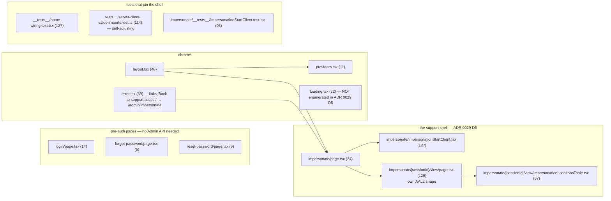
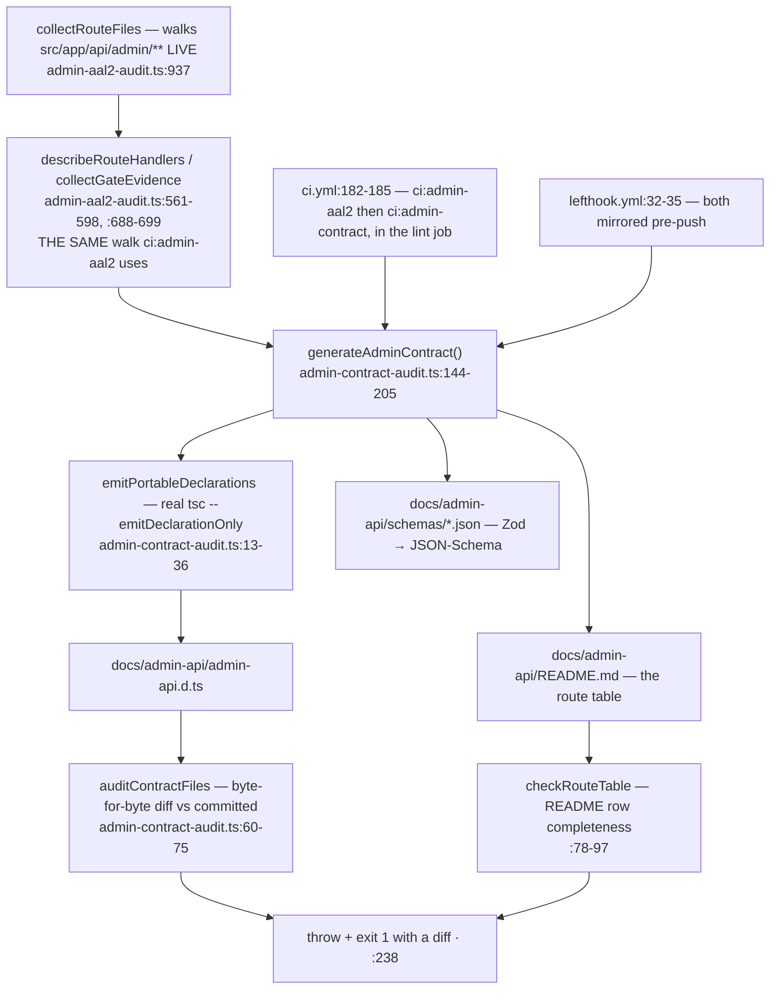

# F3 — Legacy-admin retirement and the Admin API contract

**Theme A, second half · `becdb113d` #1232 (generate + gate the contract) ·
`4ad91aa96` #1240 · `0ad5c1bdc` #1252 · `d6fdb841d` #1253 · the ten page
retirements #1254–#1263 · `f747cb7b6` #1264 (minimal legacy support shell).**

**Fourteen merges in one day (2026-09-11) deleted ten legacy admin pages.**
This is the reason `src/app/` net-shrank by 3,750 lines — the first root to
shrink across any Pathfinder window.

---

## What survives

`find src/app/admin -type f | xargs wc -l` → **14 files, 857 lines**, down from
ADR 0024's charted 91.

**This matches ADR 0029 D5 exactly** — five surviving `page.tsx`
(`impersonate`, `impersonate/[sessionId]/view`, `login`, `forgot-password`,
`reset-password`) plus chrome. `error.tsx:56-61` links "Back to support access"
to `/admin/impersonate`, confirming ADR 0029 D3 shipped.

**#1193 landed too.** `find src/components/admin` returns only
`AdminIdentity.tsx`, `AdminShellFrame.tsx`, `EndImpersonationButton.tsx`,
`ImpersonationBanner.tsx`, `nav-config.ts`, and `ui/{AdminPage,DataTable,states,format}`.
`AdminSidebar.tsx`, `nav-counts-query.ts` and the enrollment widgets are gone.

**`GET /api/admin/nav-counts` is kept deliberately** — ADR 0029 D5 says the
separate Admin app's Sidebar and Overview call it
(`src/app/api/admin/nav-counts/route.ts:1-22`, gated at `:12`).

Directory totals at HEAD: `src/app/admin` 14 files · `src/app/api/admin` 73 ·
`src/lib/admin` 51 · `src/components/admin` 17.

> **One documentation completeness gap.** `src/app/admin/loading.tsx` (22
> lines) is legitimate — a streaming fallback for the two remaining
> segment-rendered pages — but it is not named in ADR 0029 D5's "chrome that
> survives" enumeration. Not a bug; the list is simply not exhaustive at file
> level. The class matters more than the instance: **the retirement was
> planned against an enumerated file list, and the list was one file short.**
> The same class as PR 2's enumerated-guard findings.

## The Admin API contract

**Does a dropped or added route actually fail CI? Yes — proven by the
generator's design, not by prose.** `collectRouteFiles` enumerates the
filesystem live, so a deleted route yields a *"stale route row"* finding
(`admin-contract-audit.ts:95`) and an added one yields *"missing route row"*
(`:90`). The artifacts are committed, not gitignored
(`git check-ignore -v docs/admin-api/README.md` exits 1), and regenerated via
`admin-contract:generate` (`package.json:32`, the `--write` variant).

**The best structural property of the whole wave:** the contract generator and
`ci:admin-aal2` share **one** route-walk and **one** gate-shape recogniser
(`admin-contract-audit.ts:6` imports from `admin-aal2-audit.ts`). Two audits
over the same subject with two walkers is the classic drift source; this wave
avoided it.

**`docs/admin-api/` is a new directory but NOT a new top-level directory** —
it is under `docs/`. `git ls-tree -d --name-only 40e79e6a8` vs `HEAD` is an
**empty diff**: no new top-level directory in 177 merges. CLAUDE.md's rule held.

## `ci:admin-contract` is the window's one new audit

The 2026-08-26 pass recorded **21** `ci:*` audits. The `lint` job now runs
**22**. Diffing the two lists: exactly one added — **`ci:admin-contract`**,
landed by `becdb113d` (#1190/#1232). Total `ci:*` entries in `package.json`:
**24** (the 22 plus `ci:fallow` and `ci:fallow:coverage`). `lefthook.yml`
mirrors all 22. `src/__tests__/ci-audit-wiring.test.ts` (238 lines) is still
the enforcer, with `UNGATED_BY_DESIGN` (`ci:fallow`) and `CI_ONLY_BY_DESIGN`
(`ci:fallow:coverage`) matching CLAUDE.md's description exactly.

> `ci:rls-audit` runs **twice** — once in `lint` (self-skips without a DB) and
> once live in the `test` job (`ci.yml:279`). By design. Counted once.

## Retirement done right — what this wave should be copied for

Three properties worth naming, because the next large deletion should copy
them:

1. **One page per PR.** Ten retirements, ten merges (#1254–#1263), each 3–5
   `src/` files. A single 40-file deletion PR would have been unreviewable and
   unrevertable.
2. **Parity before deletion.** #1252 and #1253 cut over home and the business
   pages *after* Admin app parity, not before; the pre-auth pages and the
   support shell were never in scope.
3. **The sweep is once, at the end.** ADR 0031 chose to sweep stale references
   once (#1266) rather than sixteen times, with a recorded owner reservation
   that `docs/directory/app-admin.md` rows would age in place meanwhile. That
   reservation was correct — see the stale-doc findings in F2.
