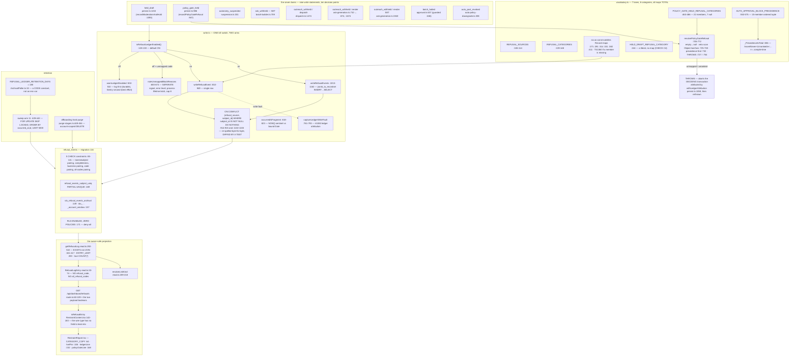

# F4 — The Refusal ledger

**Theme B · 13 merges · 43 `src/` + 10 `worker/` production files · migration 116.**
`80f68f86c` #1019 (table) · `dbc66c61c` #1031 (write path, kill switch, retention arm) ·
`95597c4b9` #1034 (five lane maps) · `220f03643` #1043 · `7349acc6d` #1042 ·
`2ef07b4f9` #1044 (set-based arm) · `15e9f0cb1` #1049 (sweep) · `9d26c5a33` #1055
(last two write sites) · `cf2199809` #1074 (the Restraint tab) · `7adabe10c` #1098 ·
`b9fb96016` #1099 · `e99a7a91f` #1111 · `7d23b7528` #1122 · `dc9f421eb` #1129.

**67 nodes.** `src/lib/refusals/` is **3 files / 2,466 lines** at HEAD — the
newest subsystem in `src/lib/` and already the eleventh-largest, with
`write.ts` alone at **1,162 lines**.

---

## The spine

## The seven lanes

| Lane | Write site | Category source | Shape |
|---|---|---|---|
| `held_draft` | `worker/jobs/response-generation/persist.ts:1153` | `HELD_DRAFT_REFUSAL_CATEGORY` — a single literal (`vocabulary.ts:244`), because CHECK C4 says this lane has no code axis | single-row |
| `policy_gate_held` | `persist.ts:986` | `resolvePolicyGateRefusal()` over `POLICY_GATE_HELD_REFUSAL_CATEGORIES` + `AUTO_APPROVAL_BLOCK_PRECEDENCE` | single-row |
| `autonomy_suspended` | `src/lib/auto-approval/suspension.ts:331` | `AUTONOMY_SUSPENDED_REFUSAL_CATEGORIES[trigger]` `:271` | single-row |
| `ask_withheld` | `src/lib/solicitation/batch-builder.ts:709` | `ASK_WITHHELD_REFUSAL_CATEGORIES[reason]` `:291` | **set-based**, up to `MAX_DATA_ROWS` 5,000 |
| `outreach_withheld` | **two writers, three call sites** — `dispatch.ts:1474` (single); `ask-generation.ts:710` (single, from `:874` and `:1674`); `ask-generation.ts:1940` (**set-based**, `settleGenerationExhaustion`) | two distinct maps over overlapping-but-separate enums (`:314` dispatch-half, `:331` render-half) | mixed |
| `batch_halted` | `src/lib/solicitation/approval.ts:637`, guarded by `refusalCategory !== null` at `:636` | `BATCH_HALTED_REFUSAL_CATEGORIES[reason]` `:382` | single-row |
| `auto_post_revoked` | `worker/jobs/publisher/auto-policy-downgrade.ts:208` | `AUTO_POST_REVOKED_REFUSAL_CATEGORIES[reason]` `:411` | single-row |

> **An accounting gap, flagged not resolved.** `vocabulary.ts:307` and
> migration `116:13` both say **eleven** call sites.
> `rg 'await writeRefusalEvent(s)?\('` over non-test production returns **nine
> statements**, across **ten** decision points (the render half is reached from
> two). The discrepancy is 10 vs 11 and does not affect correctness — every
> writer still routes through the same two exported functions — but the
> comment and the code disagree, and one of them is wrong.

## Two claims from the window, re-verified

**#1099 — *"the compiler proves `AUTO_APPROVAL_BLOCK_PRECEDENCE` is total."*
VERIFIED, and it is a type-level proof, not a test.**
`RankableBlockReason` (`vocabulary.ts:599-603`) derives the must-be-ranked keys
by `extends null` over the map's **own inferred type** — deliberately *not*
over `RefusalCategory`, with the reason written out at `:580-598`.
`AssertNever<T extends never> = T` (`:622`) is a self-consuming type;
`UnrankedIn
 = Exclude<RankableBlockReason, P[number]>` (`:634-637`); and
`type _PrecedenceIsTotal = AssertNever<UnrankedIn<typeof
AUTO_APPROVAL_BLOCK_PRECEDENCE>>` at `:656` fails `pnpm typecheck` with
`TS2344` **naming the missing member** the moment a rankable reason is dropped.
`vocabulary.test.ts:694-721` confirms by seeding a hole in the type argument.

**#1122 — *"an unmapped block reason raises its own operator signal on a dark
ledger."* VERIFIED.** `persist.ts:968-976`, guard 4's off-arm, calls
`noteUnmappedBlockReasons` (`write.ts:600-674`) **and** `noteRefusalLedgerDark`
(`write.ts:177-179`) as two distinct signals: different message constant
(`:396` vs `:318` latch), different Sentry level (`error` `:656` vs `warning`
`:519`), different latch lifetime (process-lifetime `Set` `:371` vs
per-episode boolean `:318`). The two `if`s are mutually exclusive by
construction (`persist.ts:896-901`).

## The owner-safe projection — three layers, three different guarantees

`refusal_code` (the verbatim lane code) and `all_refusal_codes` (co-occurring
block reasons) never reach an owner.

1. **Storage** — `116:171` RLS enabled with **zero policies**. ADR 0023
   Decision 5 says explicitly this is *not* the column guarantee ("RLS filters
   rows, not columns"); it forces every read through the RLS-bypassing
   `postgres` role, i.e. through application code.
2. **Query projection** — `read.ts:33-74` and the two `SELECT` lists at
   `read.ts:362-369` and `:394-401` never name either column. `read.ts:22-29`
   states the omission **is** the access control.
3. **Wire type** — `RestraintContent.tsx:142-150` validates a payload shape
   that structurally has no field for either column, so a server-side leak
   fails client validation rather than rendering.

**This is defence in depth, not drifting duplication.** Each layer asserts a
different proposition. ADR 0023's "Alternatives rejected" section explicitly
declines owner-readable RLS scoped by `account_id` for this reason — it would
need a fourth mechanism (a view, or a column GRANT) to withhold the columns.

## Duplication inside the lane

| # | Thing | Sites | Verdict |
|---|---|---|---|
| 1 | `occurredAt: 'transaction_time'` sentinel | `approval.ts:651` · `suspension.ts:347` · `persist.ts:998` · `persist.ts:1162` · `auto-policy-downgrade.ts:224` | **Legitimate.** These five lanes decide *inside* the stamping transaction and join a partner row that also uses `DEFAULT NOW()`. The other four sites pass a bound `Date` because they decide at render/dispatch time, outside the tx — the exact distinction ADR 0023's "One timestamp can still drift" section draws. Correctly **not** uniform |
| 2 | `allRefusalCodes: null` | six of seven call sites (`ask-generation.ts:750`, `approval.ts:646`, `batch-builder.ts:722`, `dispatch.ts:1480`, `auto-policy-downgrade.ts:217`, `suspension.ts:338`) | Type-required boilerplate. Not a finding |
| 3 | The `ON CONFLICT` clause | `write.ts:914-915` and `write.ts:1102-1103` | **Required duplication, and the only one in the repo that is machine-diffed.** Postgres cannot infer a partial index through a parameterised predicate (`:932-937`, `:1143-1150`), so both arms re-spell it. `write.test.ts:645-666` parses both clauses out of the source text and diffs them |
| 4 | Kill-switch suppression | one owner | **Negative finding worth recording.** All nine call sites delegate entirely to `isRefusalLedgerEnabled()` inside the two write functions (`write.ts:844`, `:1021`). The one apparent second read, `persist.ts:968`, is an early exit that avoids running the *throwing* resolver while the ledger is off — documented at `persist.ts:836-843`, and the only lane that needs it |
| 5 | Two unmerged enums for one lane | `OutreachWithheldReason` and `RenderWithholdReason`, overlapping on `lint_failed`/`moderation_high` | **Deliberate** (`vocabulary.ts:300-321`): merging would let a dispatch-only reason typecheck at a render site. Both maps are independently total. Maintenance burden, not a defect — **add to the DO-NOT-UNIFY register** |

## Invariants — measured

- **#2 outbox.** The refusal write is a companion INSERT, not an enqueue — but
  every write rides the **same transaction** as the state change it records:
  `flagged_responses` INSERT then `persist.ts:1153`; `auto_approval_policies`
  UPDATE + `account_audit_log` then `suspension.ts:331`; `solicitation_asks`
  INSERT then `batch-builder.ts:709`; `responses` UPDATE + `approval_audit_log`
  then `auto-policy-downgrade.ts:208`. A rollback takes the Refusal row with
  it. Verified by reading the transactions, not the comments.
- **#15 explicit client.** Both writers take `tx: TransactionSql` as the first
  parameter (`write.ts:833`, `:1014`); neither `write.ts` nor `read.ts` imports
  `@/lib/db/server`; `read.ts:293` takes `sql: Sql`.
- **Tenant scoping.** `read.ts` uses correlated `EXISTS` rather than `JOIN`
  specifically to avoid row fan-out (`read.ts:384-392`), and re-spells its
  tenant predicates per query block because `ci:tenant-scope` reads blocks
  (`read.ts:475`).
- **`ON CONFLICT` matches the partial index byte-for-byte** against
  `refusal_events_subject_uniq` (`116:166-169`), asserted by a test, not only
  documented.

## Defects — none LIVE

| Finding | Is it wrong? | Is it reachable? |
|---|---|---|
| `policy_gate_held` is fully built but writes nothing | No — by design | **No.** `AUTO_APPROVAL_ENABLED` defaults off (`env-vars.md:658`, `RestraintReport.tsx:134-137`) and `isGenuineAutoCandidate` (`persist.ts:963`) short-circuits before the resolver. A documented silence, disclosed to the owner by `policyGateLine()` (`RestraintReport.tsx:168-173`) |
| 6 of 22 `AutoApprovalBlockReason` members can never reach the precedence resolver | No — self-documented at `vocabulary.ts:521-543` as untested **position**, not untested **mapping** | Structurally unreachable behind `isGenuineAutoCandidate` + guard 1 |
| `resolvePolicyGateRefusal` throws inside the deciding transaction | By design — `write.ts:31-58` states a writer bug must abort | Only if a 23rd reason shipped without a map entry — which fails `pnpm typecheck` (`TS1360`) first. **Gated by CI, not by luck** |
| `warnLedgerDisabled`'s Sentry transport is fire-and-forget (`write.ts:480-491`) | No — stated tradeoff; flushing would block the deciding tx | Yes, whenever Sentry delivery fails silently. Mitigated: the structured log line is the primary, durable signal (`:472-474`) |
| `outreach_withheld`'s `unsubscribed` disposition has no writer | No — accurately documented gap; migration 111 admits the value, `OutreachWithheldReason` excludes it | **Not reachable** — no code path produces it. A placeholder for a future writer |

**No live defect surfaced.** The two headline results are both *confirmations*
of in-window claims (#1099, #1122) — which is itself worth recording: this is
the first subsystem in seven passes where every claim the window made about
itself re-resolved true.
