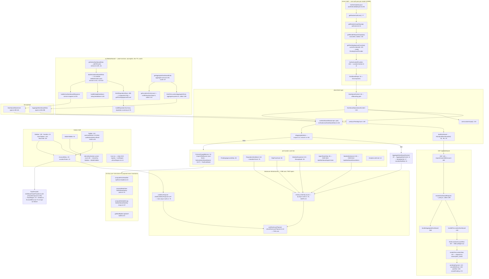

# F5 — The Console / Harbor dashboard and the 160-finding UX remediation

**Theme C · 16 merges · 362 `src/` files — the largest theme by file count.**
`0732408fa` #987 (Harbor redesign) · `e87e20319` #989 (Harbor shell) ·
`926d9b74b` #990 (glance dashboard) · `5ab6bfeee` #993 (density) ·
**`f797d2506` #1075 (223 files — 160 UX-audit findings across all 73 routes)** ·
`9e12bbc1f` #1097 · `4502ed1f8` #1110 · `75b777bfd` #1117 + `8e2acd883` #1118 +
`313a3e01f` #1119 (InfoTip / `useDisclosurePopover`) · `0bfc75c0a` #1128 ·
`dec98bab5` #1123 · `fbe6fa82c` #1138 · `9c40633f8` #1100 · `13540eed6` #1101 ·
`862a039d1` #1109.

**80 nodes.**

---

## The render path

## The payload — field by field, for the Owner Operator's benefit

Run B's summary panel was expected to reuse this. **It should not.** The exact
findings:

| Field Run B wants | Status in the dashboard payload | Evidence |
|---|---|---|
| **Rating band** | **Present but shaped wrong.** `ReputationSummary.averageStar` (`types.ts:33`, metric shape `:19-27`) is `{current, delta, priorSampleSize}`. `RatingBreakdown` (`types.ts:58-62`, `rating-breakdown.ts:26-50`) buckets **all rated reviews** by star. Neither is *pending drafts by star*, which is what the Operator's `read_pending_work` asks for (`catalog.ts:132`). No discrete band enum is on the payload at all — `RepPulseBand` (`rep-pulse.ts:34,52-57`) is computed **client-side** and never sent | ← |
| **Pending count** | **Present, and Run A already reuses the right helper.** `getPendingApprovalCountsForAccount` (`src/lib/dashboard/pending-count.ts:35-55`), called from `operator/reads.ts:236` per spec §3.1 | correct as built |
| **Posted count** | **Absent.** `ValueSummary.totalReviewsHandled` (`types.ts:66`, built `service-mappers.ts:52`) is all-time cumulative *handled*, not posted-in-window. `PerLocationKpi.recentReviewCount` (`types.ts:213`, `aggregate-queries.ts:311`) is a capped *received* sample. The Operator's `posted_7d` has its own correct reader, `readPosted7d` (`operator/context.ts:241-251`) | nothing to reuse |
| **Location list** | **Absent from the per-location DTO** (`DashboardDataActive` carries only `business:{name,createdAt}`, `types.ts:107`). The aggregate carries `locationKpis: PerLocationKpi[]` (`types.ts:207-217`) — a KPI projection, not a roster. The canonical roster is `getLocationsForAccount` (`src/lib/locations/repo.ts:64`), already shared by `aggregate-service.ts:122`, `operator/reads.ts:90,197`, `operator/context.ts:336`, `settings/voice/route.ts:75` | reuse the helper, not the DTO |

**Conclusion, and it is the pass's main correction to the Run B intake:** the
premise *"the summary panel reuses the dashboard payload"* is wrong. Run A
already reuses the **granular helper functions**, not the assembled DTOs, and
that is the right pattern. The DTOs carry Redis caching, ranking, velocity and
briefs the Operator does not want. See `03-unified-proposal.md` U1-D.

Both builders are **plain functions taking `sql`** — `getActiveDashboardData(sql, businessId, opts)`
(`service.ts:129-140`) and `getAggregateDashboardData` (`aggregate-service.ts:92`).
No React server-component context is required. That part of the premise holds.

## Disclosure ownership — a clean three-layer split, verified

| Layer | Owner | Callers |
|---|---|---|
| core (open state, ids, `pointerdown` dismissal, focus restore) | `src/components/ui/useDisclosurePopover.ts:44-102` | exactly 2 — `useMenuPopover.ts:70`, `InfoTip.tsx:75` |
| menu semantics (open-focus targeting, ArrowDown/Up, roving over `[role^="menuitem"]`) | `src/components/dashboard/shell/useMenuPopover.ts:57-167` | exactly 2 — `AccountMenu.tsx:52`, `LocationPicker.tsx:39` |
| tip (hover under `(hover:hover) and (pointer:fine)`) | `src/components/ui/InfoTip.tsx:63-167` | 6 placements — `RepPulseCard.tsx:39`, `WeeklyRecapCard.tsx:43`, `ReputationHeroBand.tsx:164`, `:195`, `NeedsAttentionList.tsx:129`, `ValueKpiGrid.tsx:42`, `:54` |

**The split is load-bearing and there is no third copy.** Grepping
`src/components/dashboard` and `src/components/ui` for any other
`addEventListener('pointerdown'|'mousedown')` or hand-rolled open/close state
returns nothing. `SettingsModal`, `EditReplyDrawer` and `PastDueModal` use
native `<dialog>`/`showModal()` — a different mechanism, called out at
`tokens.css:19-22` and `DESIGN.md:389-392, 609-614`. `InfoTip` deliberately
skips `useMenuPopover` because that hook `preventDefault`s Arrow/Home/End
before checking for an item, which would swallow page scroll for a tip
(`useMenuPopover.ts:46-51`, `InfoTip.tsx:52-61`).

**This is the cleanest de-duplication in the window** and #1118 is the model
the other findings in `02-duplication-report.md` are measured against.

## Duplication

| # | Thing | Sites | Verdict |
|---|---|---|---|
| 1 | **21 files spell a `className="card …"` root with NO shared `<Card>` component** | `account-state/{AccountStateScreens,OffboardingStatusScreen}.tsx` · `aggregate/{AggregateIntelligenceBriefCard,AggregateRankingCard,AggregateVelocityCard}.tsx` · `DashboardContent.tsx` · `kpi/{IntelligenceBriefCard,RankingCard,RecentRatingBreakdown,RecentSentimentMix,RepPulseCard,ReputationHeroBand,ReputationTrendChart,VelocityCard,WeeklyRecapCard}.tsx` · `NeedsAttentionList.tsx` · `restraint/RestraintReport.tsx` · `shell/{DashboardStatePanel,SubscriptionUnavailableCard}.tsx` · `timeline/{RunTimeline,TimelineContent}.tsx`. `grep` for `export function Card`/`export const Card` → **nothing in the repo** | **The largest structural duplication in the UI.** But the `.card` contract is a **CSS** contract (`DESIGN.md:379-388`), and a `<Card>` component would be a wrapper for a class name. Ruled **NOT worth a component** — see X-C1 in `02-duplication-report.md` |
| 2 | Arrow-chevron SVG, byte-identical `d="M5 12h14M13 6l6 6-6 6"` | `kpi/RepPulseCard.tsx:144` · `kpi/PendingApprovalsStrip.tsx:27` · `kpi/AnalyticsLinkCard.tsx:39` | **Safe to unify** — but `Icon.tsx` has no `arrow-right`/`chevron-right` entry (only `chevron-down`/`chevron-updown`, `:21-22`), so the fix is *add the registry entry*, not *refactor the three* |
| 3 | `isObject` guard, identical body | `NeedsAttentionList.tsx:216-218` · `AgentTeamStrip.tsx:152-154` · `restraint/RestraintContent.tsx:105` | Safe to unify into `src/lib/shared/` |
| 4 | `PAST_DUE_DEADLINE_FORMATTER`, identical `Intl.DateTimeFormat`, **same name**, sibling files | `account-state/SubscriptionStatusBanner.tsx:28-32` · `account-state/PastDueModal.tsx:13-17` | Safe to unify |
| 5 | Star-glyph rendering (`'★'.repeat(...)`) | `kpi/ReputationHeroBand.tsx:51-59` · `timeline/TimelineContent.tsx:211` · `reviews/EditReplyDrawer.tsx:177` · `reviews/PastReplyCard.tsx:152-153` · `reviews/ReviewFeedCard.tsx:461` | **Five sites, one `<StarRating>` missing.** Safe to unify |
| 6 | Error-state card, near-identical, **self-acknowledged** | `AgentTeamStrip.tsx:83-91` · `NeedsAttentionList.tsx:96-105`, whose comment at `:85-86` reads *"mirrors AgentTeamStrip's error state"* | Safe to unify |
| 7 | Empty-state brief card | `kpi/IntelligenceBriefCard.tsx:11-42` · `aggregate/AggregateIntelligenceBriefCard.tsx:77-111` (`SingleLocationBrief`) | **Deliberate.** The comment at `:69-76` states it is near-verbatim and *"DELIBERATELY not folded"*, pinning the one behavioural delta (the "Insights agent" label). **DO-NOT-UNIFY** |
| 8 | Rating/sentiment mini-breakdown shell (icon + `h2`, `sr-only` table, `aria-hidden` list, `rating-row`/`rating-track`/`rating-fill`) | `kpi/RecentRatingBreakdown.tsx:31-88` · `kpi/RecentSentimentMix.tsx:47-99` | Structural duplicate; the captions justify the split. Marginal |
| 9 | **Minutes→hours, two different rounding rules for one metric** | `kpi/ReputationHeroBand.tsx:61-65` (`formatHours`: integer above 10h, else 1 dp) vs `kpi/ValueKpiGrid.tsx:23` (always 1 dp) | See §Defects — **LATENT** |
| 10 | The "why" disclosure — four mechanisms for #990's one idea | `lib/dashboard/weekly-recap.ts:97-127` (`whyFor`) · `NeedsAttentionList.tsx:69-74` (`guardianReasonSentence`) · `kpi/chart-headlines.ts:14-20` (`ChartHeadline.detail`) · `lib/dashboard/rep-pulse.ts:123-160` (`repPulseBreakdown`) | Conceptual, not textual. Each produces a different sentence shape for a different card. **Marginal — name it, do not unify** |

**Counter-evidence, recorded so the audit is not read as one-sided.** Chart
infrastructure is genuinely centralised: `chart-tokens.ts`, `motion-presets.ts`,
`useMeasuredSvg.ts`, `useNearestDatum.ts`, `star-trend-plot.ts` (explicit
"single owner" comment at `:6-10`), `velocity-math.ts`. And the popover split
above is real, tested infrastructure.

## CSS — one load-bearing order dependency, one guard, and a shipped bug behind it

- `console.css:2` `@import url('tokens.css')` — intra-file order.
- **The cross-stylesheet dependency:** `console.css` is imported by the layout
  (`layout.tsx:32`), so it loads **before** any page-scoped sheet imported
  deeper in the tree (e.g. `dashboard/requests/requests.css`, imported by
  `RequestsTabs.tsx`). A same-specificity rule for `.rq-subnav` written into
  `console.css` is **silently overridden**.
- **This already shipped once.**
  `src/app/(authenticated)/_styles/__tests__/routed-tabs-breakpoint.test.ts:24-29`
  documents it: a regression that passed a source-only test and was caught in
  a browser ("round-2 review, 2026-09-03"). The guard now asserts (a) that
  `.rq-subnav`'s display rule lives in `requests.css`, not `console.css`
  (`:111-116`) and (b) that exactly one breakpoint number governs the routed
  pill bars (`:70-89`). It is a **static regex test over raw CSS text**, not a
  rendered-cascade test — `:8-11` explains why (jsdom does not apply media
  queries).
- **Token duplication: zero.** Every `--rw-*` declaration across `console.css`,
  `tokens.css`, `theme.css`, `settings.css`, `past-replies.css`, `wizard.css`,
  `requests.css` is declared exactly once, guarded by
  `src/__tests__/design-token-single-source.test.ts`. `tokens.css:15-25`
  records that a prior double-declaration (`--rw-font-mono` on both `:root`
  and `.rw-console`) was removed for this reason. **Credit where due.**

## Sizes

`src/lib/dashboard/` over 300 lines: `service.ts` 636 · `aggregate-service.ts`
432 · `aggregate-queries.ts` 359.

`src/components/dashboard/` over 300 lines: `settings/LocationsPanel.tsx` 776 ·
`reviews/PastReplyCard.tsx` 598 · `reviews/edit-reply/useEditReplyDraft.ts` 534 ·
`account-state/ImportOfferBanner.tsx` 529 · `settings/BillingPanel.tsx` 523 ·
`reviews/ReviewFeedCard.tsx` 515 · `restraint/RestraintReport.tsx` 460 ·
`settings/PerLocationOverridePanel.tsx` 409 · `reviews/EditReplyDrawer.tsx` 409 ·
`DashboardContent.tsx` 406 · `reviews/ReviewActions.tsx` 321 ·
`charts/VelocityChart.tsx` 313.

`src/app/(authenticated)/_styles/console.css` is **3,261 lines** — the largest
production file in the repo, up from 2,262 at the 08-26 baseline (**+44%**).

## Defects

**LIVE**
- **The cross-stylesheet CSS-order footgun.** Reachable, and it already caused
  a shipped bug. The guard is a regression test written afterwards, not a
  structural prevention: a *new* same-specificity rule added to `console.css`
  for any other page-scoped class would still silently lose, and only the
  `.rq-subnav` family is asserted.
- Items 2–6 above: real duplication on the currently-rendered path.
  Functionally harmless (byte-identical outputs), so a maintainability risk.

**LATENT**
- **`DashboardContent.tsx:246-261`** — a `??` fallback for `reputation`,
  commented *"Dead branch (the per-location route always sends
  `reputationSummary`)"* at `:256`. Confirmed structurally:
  `route.ts:295-298` always passes `includeReputationMetrics: true` on every
  active per-location call. Self-documented dead code.
- **The minutes→hours rounding divergence (item 9).** *Is it wrong?* Two
  formulas for one metric, yes. *Is it reachable?* **No, today** — the two
  components are scope-exclusive: `ReputationHeroBand` renders only
  per-location, and `ValueKpiGrid`'s only non-test importer is
  `aggregate/AggregateKpiCards.tsx:4`. They can never be seen side by side.
  **Becomes LIVE and user-visible the moment either is reused outside its
  current scope** — e.g. a single page showing both totals, which is exactly
  what an Operator summary panel would be.
- Item 7 (`SingleLocationBrief`) — a tracked two-copy maintenance cost, not a
  defect.
