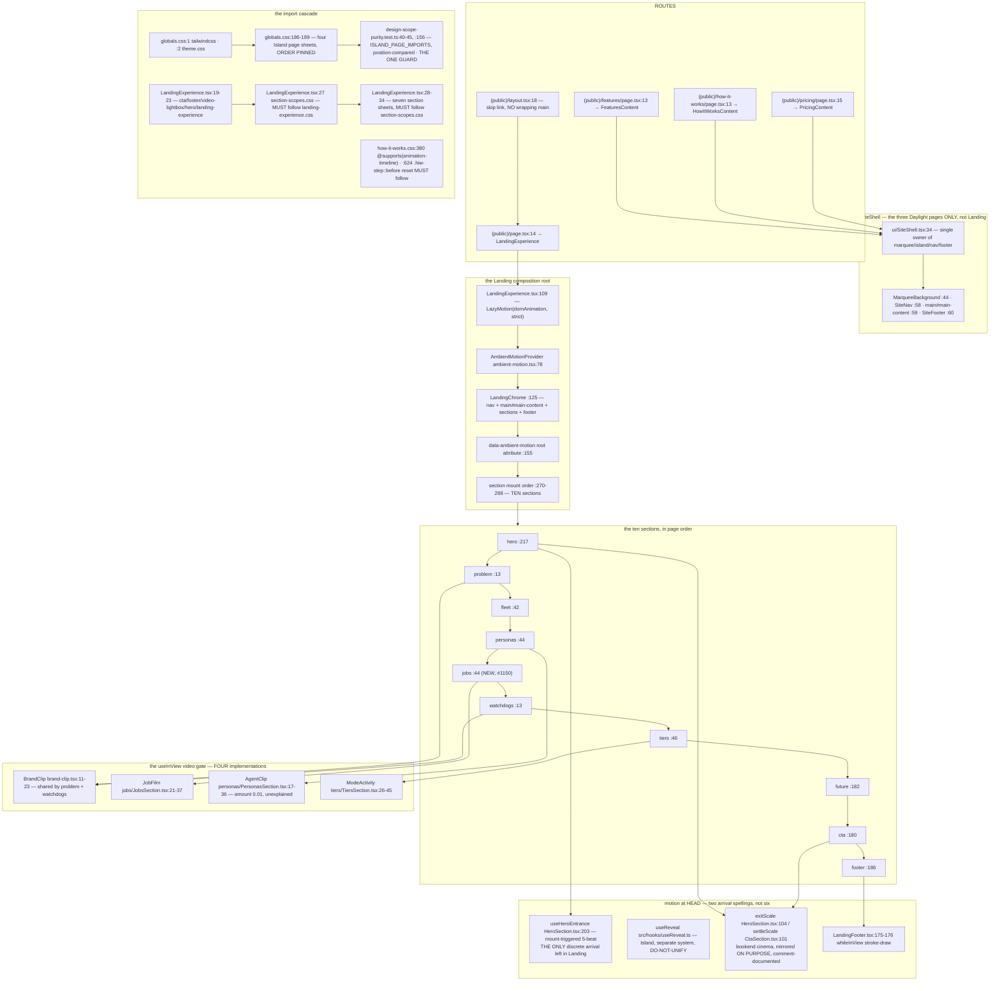

# F6 — The marketing / landing rebalance

**Theme D · 10 merges · 166 `src/` files.**
`07a2c856f` #1140 (rebalance to the five jobs, 32 files) · `d880bbacb` #1141 ·
`0816cc591` #1150 + `4bd1b90f3` #1152 + `bb28251ea` #1153 + `5d4cf4e98` #1155 +
`002285fd4` #1157 (the route map) · **`602e98930` #1174 (66 files — AI-slop and
em-dash removal across marketing AND dashboard copy)** · `e88935442` #1218
(Brand Asset Library) · **`afacb62c3` #1233 (37 files — ship the selected
design as plain sections; remove exploration)** · `9e12bbc1f` #1097.

**68 nodes.** The 2026-08-26 pass charted this surface in depth (F1/F2/F3/F6/F7);
this chart is the **delta**.

---

## The surface at HEAD



## What #1233 removed — eleven files, no orphan left

`git show --name-status afacb62c3 | grep '^D'`:

```
src/components/sections/landing/__tests__/agent-flip-card.test.tsx
src/components/sections/landing/__tests__/carousel.test.tsx
src/components/sections/landing/__tests__/staged.test.tsx
src/components/sections/landing/agent-flip-card.css
src/components/sections/landing/agent-flip-card.tsx
src/components/sections/landing/carousel.css
src/components/sections/landing/carousel.tsx
src/components/sections/landing/fleet/fleet-copy.ts
src/components/sections/landing/future/future-route.ts
src/components/sections/landing/reveal.tsx     ← the 08-26 pass's dead file
src/components/sections/landing/staged.tsx
```

`git grep` at HEAD for `fleet-copy` and `future-route` → **zero hits**. Both
deletions are clean; they were already orphaned and were removed alongside
their now-deleted callers.

## Five of the 08-26 pass's findings, re-measured — three CLOSED

| 08-26 finding | Status at HEAD | Evidence |
|---|---|---|
| Unguarded dep 1: `carousel.css` after every section sheet | **GONE** | `carousel.css`/`.tsx` deleted; no longer imported at `LandingExperience.tsx:19-34` |
| Unguarded dep 2: `watchdogs.css` after `agent-flip-card.css` | **GONE** | `agent-flip-card.*` deleted; `watchdogs.css` is now 30 lines with zero specificity-tie language (`grep -n '0,2,0\|specificity'` → no hits) |
| Anti-dep 3: `landing-experience.css` after `agent-flip-card.css`, deliberately not load-bearing | **MOOT** | same deletion |
| Guarded dep 4: `globals.css:186-189` Island page order | **STILL PRESENT, STILL GUARDED** | unchanged; pin at `design-scope-purity.test.ts:40-45`, position-compared at `:156` |
| Unguarded dep 5: `how-it-works.css` intra-file `@supports` order | **STILL PRESENT, STILL UNGUARDED** | `@supports` block `:380-393`; the reset `.hiw-step::before { animation:none; transform:none }` at `:624` inside `@media (max-width:1040px)`, with the comment *"same specificity, so source order is what wins"*. `git grep -l 'hiw-step'` finds only `how-it-works-css.test.ts`, which pins `position: static` (`:40`) and never the order |
| **`reveal.tsx` orphan + stale `docs/directory.md:103` row** | **BOTH CLOSED** | `test -f src/components/sections/landing/reveal.tsx` → does not exist. `grep -n 'reveal\|Reveal' docs/directory.md` → **zero hits** |

### But #1233's own restructure created a NEW unguarded dependency

`section-scopes.css` must load **after** `landing-experience.css`, and each of
the seven per-section sheets must load **after** `section-scopes.css`. Stated
in-file at `section-scopes.css:13-14` and in the root's comment at
`LandingExperience.tsx:24-27`. The current order is correct
(`landing-experience.css` `:23`, `section-scopes.css` `:27`, sections `:28-34`).

**No test reads `LandingExperience.tsx`'s import statements.**
`focus-visible-marketing.test.ts` reads the *content* of both sheets for
focus-ring rules (`:24`, `:44`) and never their relative position — the same
"reads the file but not the order" gap the 08-26 pass named as CS15.

> **Net: two unguarded dependencies removed, one new one created, the guarded
> one untouched. The count is stable at three unguarded + one guarded — but
> the members are not the same three.** A pass that only counted would have
> reported "no change."

## The arrival grammar went from six spellings to two — by deletion, not unification

| 08-26 spelling | At HEAD |
|---|---|
| `Staged` (`staged.tsx:52-66`) | **DELETED** |
| `useHeroEntrance` (`HeroSection.tsx:203-212`) | **LIVE**, unchanged at `:203-213` |
| `armedFadeProps` (`FleetSection.tsx:99-104`) | **DELETED** — `fleet/FleetSection.tsx` read in full, now zero motion imports, fully static |
| `FutureCard` inline (`FutureSection.tsx:56-64`) | **DELETED** — `future/FutureSection.tsx` read in full, now zero motion imports, map/tabs based |
| `reveal.tsx:48` (dead) | **DELETED** |
| `useReveal.ts:24` (Island) | unchanged, still separate, still **DO-NOT-UNIFY** |

**The 08-26 pass's U3 recommended consolidating onto `Staged`. The window
deleted `Staged` and three of its siblings instead, and reached the same
practical end state** — one canonical live arrival spelling inside Landing.
Worth recording plainly: *a unification handoff was satisfied by a deletion
nobody connected to it.* Both approaches were legitimate; the pass's proposal
was not wrong, it was simply overtaken.

Two grammars sit outside the 08-26 pass's "arrival" definition and were never
inventoried by it; both confirmed pre-existing (`git log 72dc58ac..1d9b251c`
returns empty for each): the bookend-cinema `exitScale`/`settleScale` mirror
(from #953) and `LandingFooter`'s `whileInView` stroke-draw.

## Size — the surface got SMALLER

| | 08-26 baseline | HEAD | Δ |
|---|---:|---:|---:|
| `src/components/sections/**` + `src/app/(public)/_styles/**` | 100 files / 17,141 lines | **82 files / 14,684 lines** | **−18 / −2,457** |
| CSS share | 46% | **45.3%** | flat |
| `src/components/sections/landing/` | 38 files / 8,240 lines | **44 files / 6,311 lines** | +6 files / **−1,929 lines** |

Files went up inside `landing/` (per-section `*-copy.ts` extraction) while
lines dropped sharply (four large motion-primitive files plus their CSS and
tests deleted). **Consistent with #1233's stated goal.** This is the only
subsystem in seven passes to shrink.

## The headline duplication — "the five jobs" has no owner

The canonical enumeration is `src/components/sections/landing/jobs/jobs-copy.ts:55-101`
(`JOBS`: **Respond / Protect / Request / Brief / Measure**, each with
`claim`/`body`/`agents`/`surface`).

```
$ grep -rn "from.*jobs-copy"
src/components/sections/landing/jobs/JobsSection.tsx:8
src/components/sections/landing/jobs/__tests__/JobsSection.test.tsx:6
```

**Two importers. Zero cross-page sharing.** Three other structured taxonomies
of the same territory exist, none importing it, none agreeing:

| Source | Taxonomy | Collision |
|---|---|---|
| `jobs/jobs-copy.ts:55-101` | Respond · **Protect** · Request · Brief · Measure | canonical |
| `features/FeaturesContent.tsx:39-63` (`FEATURES`/`FEATURE_GROUPS`) | Respond · Request · Brief · Measure · **Govern** | **"Protect" renamed to "Govern"** for the same agents (Guardian · Judge · Governor). The comment at `:39-45` *acknowledges* the rename ("Govern closes the page on purpose") and the code does not resolve it |
| `how-it-works/HowItWorksContent.tsx:117-122` (`OVERVIEW`/`HOOD`) + `:131-166` (`LOOPS`) | a 6-step pipeline (Watch/Triage/Draft/Gate/Post/Judge) **plus** 4 loops: Request · Brief · Measure · **Record** | **"Record" is a fifth concept present in neither other taxonomy** |
| `pricing/PricingContent.tsx:26-52` (`PLANS[].features`) | per-tier prose bullets, **no job-verb labels at all** | |

**This is the duplication finding this pass was asked to look for by name: one
product taxonomy, re-cut in four components, with one outright naming
collision that a code comment admits.**

- **Is it wrong?** Yes, as consistency: a visitor reading `/` (or `/features`)
  and then `/how-it-works` sees two different five-item lists for "one system,
  five jobs" and cannot map them one-to-one.
- **Is it reachable?** **Yes, by any visitor reading two of the four pages.**
  No functional breakage — each page is internally consistent. Not caught by
  any test: the three `*Content.test.tsx` suites each assert their own page's
  copy in isolation.
- **LIVE**, as a marketing-coherence defect. Carried as **H5**.

## Secondary duplication — the `useInView` video gate, four times

The "video decodes only near viewport, falls back to a still under reduced
motion or on error" pattern, ~15 lines each:

- `brand-clip.tsx:11-23` (`BrandClip`) — shared by problem + watchdogs
- `jobs/JobsSection.tsx:21-37` (`JobFilm`)
- `personas/PersonasSection.tsx:17-36` (`AgentClip`)
- `tiers/TiersSection.tsx:26-45` (`ModeActivity`)

Two sections correctly reuse `BrandClip`; three reimplement it. The thresholds
already disagree — `AgentClip` uses `amount: 0.01`, the other two use
`amount: 0.05`, with **no test asserting they should agree and no comment
explaining the difference**.

- **Is it wrong?** Structurally yes.
- **Is it reachable?** Cosmetic today; all four behave correctly. **LATENT.**
  A fifth copy-paste that omits the `!reduced` guard would autoplay under
  `prefers-reduced-motion` with nothing catching it — **the same failure shape
  the 08-26 pass named as its D2 for the old `AmbientVideo` call sites,
  recreated one layer up in the new lazy-load wrappers.** That recurrence is
  the finding, more than the four copies.
