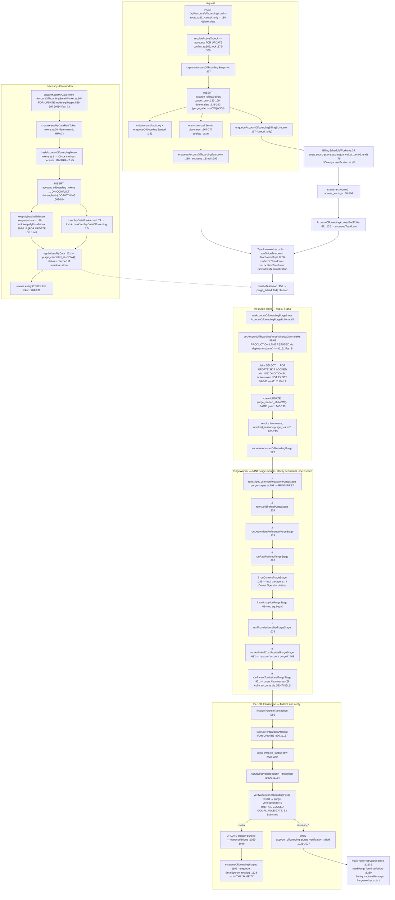

# F7 — Owner offboarding, the purge lane, and billing

**Theme E · 5 merges · 12 `src/` + 15 `worker/` production files.**
`715b88f58` #1070 (name the in-tx account lock — **comment-only, 40 lines**) ·
`91b32506a` #1121 (redact the Stripe Customer on `delete_data`; bound the
out-of-order retry) · `dd883b1af` #1126 (one owner for the lane's Stripe retry
policy) · `3fc206806` #1130 (a detached PaymentMethod is a retention, not an
erasure) · `aa2d5b2da` #1151 (#614 — the purge-window override never claims a
row with a live keep-my-data token).

**87 nodes.** Baseline: `PATHFINDER-2026-08-26/01-flowcharts/F11-purge-verification.md`.
Every number below was re-measured, not carried.

Sizes at HEAD: `worker/jobs/account-offboarding/purge-stages.ts` **1,261**
(was 1,012) · `src/lib/account-offboarding/purge-verification.ts` **801**
(was 763) · `table-disposition.ts` **510** (was 422) · `purge-sentinels.ts`
**69** (unchanged) · `keep-my-data.ts` 383 · `AccountOffboardingPurgePoller.ts`
273 · `AccountOffboardingEmailWorker.ts` 643.

---

## The lane



## Nine stage runners now, not eight

The 08-26 pass measured **eight** (it correctly corrected the brief's seven).
#1121 added a ninth. Full list with call order:

| Order | Runner | `file:line` | Called at |
|---:|---|---|---|
| 1 | `runStripeCustomerRedactionPurgeStage` | `purge-stages.ts:792` | `PurgeWorker.ts:103` |
| 2 | `runAuthBindingPurgeStage` | `:119` | `:104` |
| 3 | `runDependentReferencePurgeStage` | `:179` | `:105` |
| 4 | `runRawPayloadPurgeStage` | `:492` | `:106` |
| 5 | `runContentPurgeStage` | `:245` | `:107` |
| 6 | `runAnalyticsPurgeStage` | `:614` | `:108` |
| 7 | `runProviderIdentifierPurgeStage` | `:638` | `:109` |
| 8 | `runAuditAndCostPayloadPurgeStage` | `:682` | `:110` |
| 9 | `runParentTombstonePurgeStage` | `:921` | `:111` |

`PurgeWorker.ts:74-116` awaits all nine strictly sequentially — no
`Promise.all` — then `finalizePurgeInTransaction`.

### A LIVE documentation defect inside the new stage

The docstring above `runStripeCustomerRedactionPurgeStage`
(`purge-stages.ts:753-763`, headed **"ORDERING (D5)"**) says the stage *"runs
LATE — after `runAuditAndCostPayloadPurgeStage` and before
`runParentTombstonePurgeStage`."*

**That is false at HEAD.** `PurgeWorker.ts:80-101` carries its own comment
block titled *"THE STRIPE CALL RUNS FIRST — this INVERTS the original D5 and
the reason is worth stating, because D5's own rationale was false"*, and the
call order (`:103` before `:104`) runs it first.

Two comments in two files contradict each other; the stale one was not deleted
when the ordering was inverted. **Is it wrong?** Yes, as documentation. **Is it
reachable as a code defect?** No — the code is internally consistent and the
*correct* rationale exists. The risk is to a future reader of `purge-stages.ts`
in isolation, who would trust a comment describing behaviour that no longer
exists. Carried as **H6** with the two stale-doc findings from F2.

## #892's QUALIFIED verdict — re-measured, unchanged

```
$ rg -n "'scrubbed:'|scrubbed:" src/lib/account-offboarding worker/jobs/account-offboarding
```
24 hits; 20 are live production literals, **split exactly 10 ↔ 10**:

- **Writer** `purge-stages.ts`: `:214, :225, :535, :623, :624, :646, :647, :658, :659, :707`
- **Verifier** `purge-verification.ts`: `:283, :284, :300, :301, :354, :360, :389, :390, :402, :534`

Same ratio the 08-26 pass reported, **even though every absolute line number
shifted** — the new stage inserted ~150 lines above the unaffected sites. The
window's growth (a ninth stage, four new tables, migration 120's tables)
touched neither side of the literal.

`'account purged'`: exactly 2 hits, split 1 ↔ 1 —
writer `purge-stages.ts:708`, verifier `purge-verification.ts:535`.

**Is there one owner now?** No. `purge-sentinels.ts` (69 lines, read in full)
holds exactly the nine #972 values at `:51-69` — `businessName`, `tone`,
`ownerName`, `accountName`, `userName`, `trackedKeywords`, `accountFlags`,
`emailPrefix`, `emailSuffix`. Neither `'scrubbed:'` nor `'account purged'`
appears in it. **#1121/#1126/#1130/#1151 did not touch this gap; the 08-26
QUALIFIED verdict holds byte-for-byte.**

The `'account purged'` site is still the one comparison using `<>` rather than
`IS DISTINCT FROM`, against the file's own rule at
`purge-verification.ts:116-124` — currently harmless because
`impersonation_sessions.reason` is `TEXT NOT NULL`. Unchanged from 08-26.

> **Why this matters and is not pedantry.** The verifier is a **fail-closed
> compliance gate**. A drift on the *verifier* side converts a failed purge
> into a **PASS**. Twenty hand-typed literals hold that property together.

## The Stripe retry policy — #1126 gave it an owner, and two sites still shadow it · **LIVE**

**Owner:** `isRetryableStripeError`, `src/lib/account-offboarding/stripe-retry-policy.ts:61`.
Its header (`:1-29`) states the scope: one policy for the offboarding lane,
vocabulary from `payments/stripe-error-inspect.ts` + `shared/error-inspect.ts`,
and it must never absorb `worker/jobs/billing/stripe-overage-error.ts` (a
deliberately divergent 409 rule).

**Correct callers (2):** `stripe-customer-redaction.ts:53, :429` ·
`stripe-invoices.ts:6, :116, :426`.

**Two private copies with the SAME NAME, byte-identical to each other and
weaker than the owner:**

| Copy | Guards |
|---|---|
| `worker/jobs/account-offboarding/teardown-stripe.ts:121-134` | `stripe.subscriptions.cancel` at `:104` — **every `delete_data` teardown with an active subscription** |
| `worker/background/pollers/AccountOffboardingReactivationResetPoller.ts:175-188` | `stripe.subscriptions.update` at `:117` — **every stale-claim recovery cycle** |

Both bodies hardcode four type strings and have **no socket-code branch at
all**. The owner reads `RETRYABLE_STRIPE_ERROR_TYPES` /
`PERMANENT_STRIPE_ERROR_TYPES` from the vocabulary module, handles 4xx/5xx
separately, **and** falls through to `RETRYABLE_NETWORK_ERROR_CODES`
(`stripe-retry-policy.ts:61-79`).

- **Is it wrong?** Yes. #1126's stated goal was *"one owner for the
  offboarding lane's Stripe retry policy"*, and two sites **in that lane**
  still hand-roll a weaker one.
- **Is it reachable?** **Yes, routinely** — neither call site is an edge case.
  A Stripe error type present in `RETRYABLE_STRIPE_ERROR_TYPES` but absent
  from the four hardcoded strings, or any socket-level `code`, is silently
  treated as non-retryable at these two sites and correctly at the other two.
- **LIVE.** And **worse than an anonymous duplicate**: the copies carry the
  *same identifier* as the shared export, so a reader in either file sees
  `isRetryableStripeError(err)` and reasonably assumes it is the owner.
  **Shadowing across a module boundary, by name.** Carried as **H3**.

A third posture exists: `BillingScheduleWorker.ts:79` does **no** retry
classification at all, relying on blind BullMQ attempts via the generic catch
at `:126-136`. Defensible for that call shape, but it makes **three** Stripe
retry postures across the lane's five Stripe call sites.

**Stale doc rides along:** `src/lib/payments/stripe-error-inspect.ts:9-15`
still names `stripe-invoices.ts` as the module that *"applies its own retry
policy."* True before #1126, false now.

## The in-tx account lock (#1070) — the claim is IN the code

- **Where:** `acquireBillingLock` — `src/lib/accounts/billing-locks.ts:26-35`,
  `pg_advisory_xact_lock(hashtext(accountId + ':overage_sync'))`.
- **Inside a transaction?** **Yes.** Called at
  `worker/jobs/billing/UpdateStripeOverageWorker.ts:73`, inside the
  `sql.begin` opened at `:70` and not closed until `:161`. The `accounts` row
  `FOR UPDATE` at `:93` is in the same callback. `pg_advisory_xact_lock`
  releases at transaction end by design, so it is meaningful only inside one —
  which this is. **CLAUDE.md's "`FOR UPDATE` is a no-op outside `sql.begin()`"
  trap does not apply here.**
- **What it guarantees:** two overage recomputes for the same account — even
  on two Railway replicas — serialise, because lock + row lock + the Stripe
  retrieve and mutation (`syncStripeOverageItem`, called `:145`) all run inside
  one transaction keyed by `accountId`. Different accounts take different
  locks.
- **In the code, not only the commit message.** `worker/index.ts:452-459`
  carries it verbatim, and `overage-sync.ts:10-16` restates it.
  `concurrency: 1` (`worker/index.ts:450`) and `assertSingleConcurrencyWorker`
  (`:464`) are explicitly demoted to defence in depth — exactly #1070's intent.

**#1070's production diff is comment-only (40 comment lines, 0 code).** It is
one of three such merges in the window, and the best argument for the counting
rule being about files rather than behaviour: it changed no behaviour and
still deserved its ledger line, because it moved a load-bearing correctness
claim from tribal knowledge into the tree.

## Other duplication

- **Three classifiers over one vocabulary.** `stripe-error-inspect.ts:19-31`
  owns the type sets; `stripe-overage-error.ts:18-58` and
  `stripe-retry-policy.ts:31-74` each re-derive from them plus
  `RETRYABLE_NETWORK_ERROR_CODES`. **Deliberate and documented** (the 409
  divergence) — not a finding, but worth naming as a third reader.
- **`DELETABLE_BY_BUSINESS` vs `ABSENT_BY_BUSINESS_TABLES` — two hand-typed
  `Set`s that should mirror and do not.** `worker/jobs/account-offboarding/purge-helpers.ts:61-75`
  (13 tables) and `purge-verification.ts:772-784` (11 tables). The difference
  is legitimate — `zernio_connections` and three others are deleter-side only
  because they get dedicated verifier branches (e.g.
  `purge-verification.ts:264-272`) — but **nothing asserts the two sets are
  consistent.** A table added to one and not the other silently either never
  gets swept, or never gets verified. **LATENT**, and it is the same
  enumerated-scope class as PR 2. Carried as **H9**.
- **Tombstone predicates:** none beyond the sentinel set.
  `purge-sentinels.ts` is genuinely the one owner for those nine values; both
  sides import and neither re-types a sentinel literal. **Credit to #972.**

## Invariants

- **#2 outbox.** Every transition pairs with a `job_outbox` write in the same
  tx: `enqueueAccountOffboardingPurge` inside the poller's `sql.begin`
  (`AccountOffboardingPurgePoller.ts:93, :227`);
  `enqueueOffboardingPurged` + the `purge_receipt` email both take `tx` and
  ride the finalize transaction (`purge-stages.ts:1102, :1123`) — the receipt
  was moved *into* the tx precisely so a post-commit crash cannot lose it
  (`:1106-1120`). The in-flight tuple is re-spelled by hand at
  `purge-stages.ts:601`, matching `ci:outbox-status`'s member-and-order
  contract.
- **#11 subscription guard.** `subscriptionGrantsFullAccess`
  (`src/lib/shared/subscription-status.ts:54`) at
  `UpdateStripeOverageWorker.ts:112`, plus the offboarding-lifecycle guards
  `getOffboardingState`/`isBillingManagementBlocked`/`isBillingMutationBlocked`
  (`gate.ts:71, :189, :165`) at `:101-107, :154-156`. A billing worker checks
  **both**, in the fixed order billing-lock → account-row-lock →
  offboarding-state-read (`:71-107`).
- **#15 explicit client.** Zero `@/lib/db/server` imports across every file
  read for this chart. Every stage takes `sql: postgres.Sql` as parameter 1;
  `verifyAccountOffboardingPurge(input, exec)` (`purge-verification.ts:40`);
  `runStripeCustomerRedactionPurgeStage(sql, resolveStripe, row)` takes the
  Stripe client as an **injected factory** and never imports `getStripe()`
  itself (`purge-stages.ts:792-803`).
- **Idempotency.** Per-operation Stripe keys everywhere:
  `stripeCustomerRedactionIdempotencyKey(offboardingId)`
  (`stripe-customer-redaction.ts:217-219`) ·
  `accountOffboardingTeardownStripeIdempotencyKey` (`teardown-stripe.ts:76-81`)
  · `accountOffboardingBillingIdempotencyKey` (`BillingScheduleWorker.ts:28-37`)
  · the overage lane's key embedding `operationScope` = `outbox:<id>:corr:<id>`
  (`overage-sync.ts:97-104`) so a BullMQ retry re-sends the same key while a
  fresh outbox row gets a fresh one. Postgres-side:
  `ON CONFLICT (token_hash) DO NOTHING` (`AccountOffboardingEmailWorker.ts:612`)
  and deterministic outbox ids (`outbox.ts:255-270`).
- **#5 tokens never stored raw.** `createKeepMyDataRawToken` (`tokens.ts:20`)
  → `hashAccountOffboardingToken` (`tokens.ts:6`); only the hash is persisted.

## Defects

| Finding | Wrong? | Reachable? |
|---|---|---|
| **Stripe retry-policy shadowing (§above)** | Yes | **Yes, routinely. LIVE** |
| The D5 ordering docstring contradicts the call order | Yes, as documentation | No runtime effect. **LIVE as a doc defect** |
| `runAuthBindingPurgeStage`'s unlocked re-validation — `revalidateAuthBinding` (`purge-stages.ts:146-177`) re-reads both predicates inside `sql.begin` (`:151`) taking **no row lock**, and that tx commits before `supabase.auth.admin.deleteUser` at `:130` | Yes, against the literal rule | **LATENT.** `users.auth_id` is `VARCHAR(255) UNIQUE`, so exploiting the window needs the purged row to release `auth_id` and another account to claim the same value strictly inside the gap. No such writer found. **Unchanged from 08-26, still unproven** |
| `DELETABLE_BY_BUSINESS` ↔ `ABSENT_BY_BUSINESS_TABLES` unasserted | Yes | **LATENT** — fires on the next table added to one and not the other |
| `owner_leads` PII survives a `delete_data` purge | Yes | **Conditionally LIVE** — `grep` confirms zero `owner_leads` reference in `purge-stages.ts`, `purge-verification.ts` or `table-disposition.ts` at HEAD. Reachable iff the owner used the public lead form pre-signup. **Unchanged from 08-26; see `07-handoff-reverification.md` §C** |
