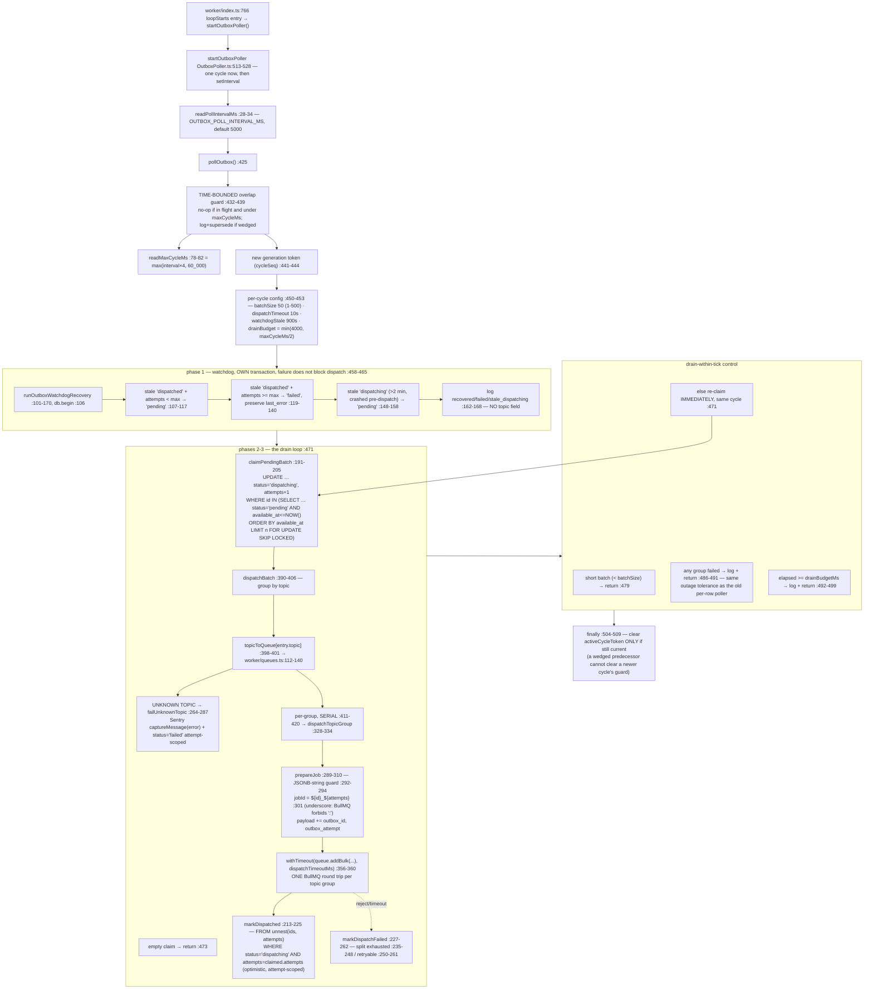

# F8 — The outbox dispatch tick, the perf wave, and the worker-health lane

**Theme H · 8 merges · 11 `src/` + 4 `worker/` files · migrations 117, 118, 119.**
`862dbf2b6` #1071 (bulk dispatch per topic group + drain within the tick) ·
`e4294692d` #1069 · `f87c80622` #1073 · `e180360bb` #1072 ·
`132aacc31` #1146 (admin-alert claim-before-send; the three deliberate
lock-across-HTTP sites) · `65affb22a` #1148 (migration 117 `admin_audit_log`) ·
`8faf5c317` #1156 (migration 118 `poller_heartbeats` — closes the
`isJudgeHealthy` blind spot, #949) · `7a1484a93` #1175 (migration 119 —
deny-all RLS on `job_outbox`).

**56 nodes.**

---

## The dispatch tick after #1071

## The in-flight status contract — #1071 added no new spelling site

Canonical owner: `src/lib/shared/job-outbox-status.ts:34` —
`OUTBOX_IN_FLIGHT_STATUSES = ['pending','dispatching','dispatched'] as const`.

**Every production spelling site:** `src/lib/responses/judge-store.ts:127` ·
`src/lib/reviews/import-consent.ts:729` ·
`src/lib/solicitation/release.ts:555, :630` ·
`src/lib/responses/generation-state.ts:14` ·
`src/lib/past-replies/load-replies.ts:282` ·
`src/lib/solicitation/batch-view.ts:436` ·
`src/lib/shared/job-outbox-helpers.ts:320, 362, 404, 442, 478, 563, 597, 756, 818, 861, 936, 1022` ·
migrations `011:9`, `030:21`, `076:72,91`, `080:93,102`, `114:105`.

**The audit checks members AND order.** `scripts/ci/outbox-status-audit.ts`
binds a `status IN (…)` group to `job_outbox` only when it names a
*distinctive* status (`'dispatching'`/`'dispatched'`, `:205`, from
`job-outbox-status.ts:52`) **and** is alias-qualified or sits in SQL naming
`job_outbox` (`:206-209`). It then compares `group.members === CANONICAL`
(`:210`), where `CANONICAL = OUTBOX_IN_FLIGHT_STATUSES.join(',')` (`:87`) — a
string equality over the **comma-joined, source-order-preserved** list. A
reordered-but-equal set fails. The migration allowlist (`:63-76`) carries the
two historical divergences (004's missing `'dispatching'`; 065's
post-dispatch-only index) with a stated reason each, since an applied
migration cannot carry a suppression pragma.

**Did #1071 add a spelling site? No.** `OutboxPoller.ts` never spells the
tuple. Every predicate in the rewritten file uses single-status equality
(`:110, 111, 131, 134, 145, 151, 152, 194, 197, 219, 222, 242, 245, 255, 258, 268, 281, 284`),
gated by attempt-scoped `unnest`, not by the in-flight set. **A rewrite of the
most outbox-dense file in the repo that did not touch the byte-for-byte
contract is a good result and is recorded as one.**

## The heartbeat (#1156, migration 118) — and what its shape constrains

`poller_heartbeats` is **two columns** — `poller_name TEXT PRIMARY KEY`,
`last_cycle_at TIMESTAMPTZ NOT NULL DEFAULT NOW()`
(`118_poller_heartbeats.sql:67-70`), deny-all RLS, `REVOKE ALL FROM anon,
authenticated` (`:78-81`).

**What that shape constrains:** one fact per named loop — *when did this loop
last finish a cycle without throwing*. The row is UPSERTed in place, never
appended, so there is **no history, no per-cycle duration or error metric, and
no multi-replica disambiguation**. "Just started failing" and "down for days"
are indistinguishable beyond the single stale timestamp.

| Role | Site |
|---|---|
| Writer | `src/lib/shared/poller-liveness.ts:61-70` (`recordPollerCycle`) — **exactly one call site**, `JudgeSweepPoller.ts:61`, as the **last** statement, only after every `enqueueJudgeVerdict` succeeded (`:46-61`). An idle sweep still records (`:30-33`); a throwing cycle records nothing |
| Reader — the gate | `src/lib/responses/judge-health.ts:73-131` (`isJudgeHealthy`), Arm 3 at `:122-130` — `readPollerLiveness(sql, POLLER_JUDGE_SWEEP)`, **fails closed** on `null` (never ran) or `ageSeconds >= JUDGE_SWEEP_LIVENESS_LIMIT_SECONDS` (15 min, `:21, :27`) |
| Reader — alerting | `worker/background/pollers/health-alert/checks.ts:441-456` (`checkJudgeSweepLiveness`), collected at `:561` |

**Why Arm 3 had to exist:** Arm 1's staleness check uses
`EXISTS(job_outbox …)` — the sweep's **own output**. A sweep that never runs
makes Arm 1 vacuously false **forever** (`judge-health.ts:55-66`, migration
118 header `:11-26`). That is the #949 blind spot, and it is a textbook case
of a health check whose predicate depends on the thing it is checking.

**Invariant #3 still enforced, unchanged.** `worker/jobs/publisher/judge-gate.ts:18-38`
(`applyJudgeGate`) and `:42-60` (`applyJudgeGateInTx`) both call
`isJudgeHealthy` and downgrade to owner review when it is false. #1156 closed
the blind spot *inside* the existing gate rather than changing its contract.

**Only Judge has a heartbeat.** Migration 118's own comment (`:37-38`) says a
second poller adds a **row**, not a migration, and that only `judge_sweep` is
written by that change. Confirmed: `OutboxPoller` calls neither
`recordPollerCycle` nor the log-only
`notePollerActivity`/`maybeLogPollerHeartbeat`
(`worker/background/poller-heartbeat.ts`, used only by `HealthAlertPoller.ts:13, 103, 106`).
**The platform's single most load-bearing loop has no dead-man switch** — its
liveness is inferred indirectly from stuck/failed-outbox-by-topic checks.
Consistent with the migration's stated scope, so a scoping choice, not an
oversight — but it is the obvious next row. Carried as **H10**.

## `src/lib/db/admission.ts` — the #773 chokepoint survived the perf wave

Still wrapping all three singletons in `src/lib/db/server.ts`: `sql` (`:58-67`,
cap `SHARED_POOL_MAX`), `sqlRead` (`:128-134`), `sqlUnsubscribe` (`:154-160`,
cap 2). Every perf-wave module inspected — `require-owner-access.ts:125, :144`,
`get-request-scope.ts:63`, `dashboard/service.ts`, `admin/business-summary.ts`,
`judge-health.ts`, `ask-generation.ts` — takes `sql`/`tx` as an explicit
parameter, and the composition roots hand it the gated singleton.
**No perf-wave file constructs its own ungated `postgres(...)` client.**
`withAdmissionControl` (`admission.ts:329-435`) still proxies
`begin`/`reserve`/lazy dispatch; the reentrant-bypass counter (`:161-172`) is
untouched.

Dedicated per-poller clients (`HealthAlertPoller.ts:37-39` via
`createDedicatedPostgresClient`) are deliberately ungated (`server.ts:113-120`)
— pre-existing policy, not a wave-introduced bypass.

**No bypass found.** Recorded plainly because "never 'fix' p95 via
`DB_POOL_MAX`" is a standing CLAUDE.md gotcha and this was a perf wave.

## The two files past 1,000 lines

**`worker/index.ts` = 1,006.** Sections: imports `:1-149` · constants +
`shouldRunFailoverPoller` `:150-192` · Fastify app `:194-197` ·
**~35 `new Worker(...)` registrations `:199-510`** · `workersByQueue` +
breadcrumb/error-sink loop `:512-575` · re-exports `:577-580` · `main()` with
health routes, five webhook ingress registrations and the 23-entry
`loopStarts` boot-stagger `:584-852` · shutdown + `unhandledRejection`/
`uncaughtException` `:854-1006`.

**What would have to move:** it is six lines over, so any extraction clears
it — but the homogeneous block is section 4, the ~290 lines of
`new Worker(QUEUE_NAMES.X, handler, opts)` at `:219-510`. Moving it into a
`registerQueueWorkers(sql, …)` factory cuts ~280 lines **and keeps
composition-root status**, because invariant #15 derives root status from
*registration in `worker/index.ts`*, not from file position — the registration
*call* can stay.

**`src/lib/shared/job-outbox-helpers.ts` = 1,027**, exporting **19** `enqueue*`
helpers (`:256, 294, 337, 379, 417, 452, 505, 537, 573, 609, 654, 686, 728,
792, 836, 906, 952, 979, 1005`) against **37** topics in
`src/lib/shared/queue-names.ts:12-71`. **19 have a helper; 18 do not.**

> ### A LIVE documentation defect in CLAUDE.md itself
>
> `.claude/CLAUDE.md:47` says a topic with no helper is *"(18 of 32 topics
> today — do not backfill on spec)"*. **The numerator is right by
> coincidence; the denominator is stale.** Measured: 37 topics, 19 helpers,
> 18 without. `AGENT_TURN`, `AUTONOMY_SUSPENDED_NOTICE` and
> `AUTONOMY_ADMIN_ALERT` are among those added since, each with a helper —
> which is why 18 stayed 18 while 32 became 37. One-line fix; carried as
> **H6** with the other stale-doc findings. It is exactly the class
> `07-handoff-reverification.md` §F describes: a number in prose with nothing
> deriving it.

## The three deliberate lock-across-HTTP sites (#1146) — one framing owner, three local rationales

| Site | Lock | External call |
|---|---|---|
| `worker/jobs/publisher/edit-publish.ts:198` (`sql.begin`) | `reviews FOR UPDATE` `:205`, `responses FOR UPDATE` `:228, :259` | `deleteReply` `:276` then `publishReply` `:304` — the DELETE→POST→409-verify round trip. Docblock `:14-17` |
| `worker/jobs/billing/UpdateStripeOverageWorker.ts:70` (`sql.begin`) | `acquireBillingLock(tx, account_id)` `:73` + `accounts FOR UPDATE` `:93` | Stripe retrieve + mutation via `syncStripeOverageItem` `:145` (retrieve at `overage-sync.ts:267`). Documented at **`worker/index.ts:453-464`** |
| `worker/background/pollers/CleanupAbandonedSignupsPoller.ts:122` (`sql.begin`) | per-email advisory lock `:127` → `users FOR UPDATE` `:138` | `deleteUser` across a 10 s race `:207`. Docblock `:24-27`, `:30-45+` |

**One owner or three copies? One cross-cutting owner plus three independent
local rationales — not three copies of the same text.**
`git show --stat 132aacc31` shows #1146 touched **none of these three files**:
the "these three are deliberate" framing is ONE bullet in
`.claude/rules/worker-layout.md` (+1 line) with the WHY in
`.claude/reference/lab-notes/postgres.md` (+72 lines) — exactly the
rule-points / lab-notes-explains convention. Each code file carries its own
pre-existing, site-specific correctness argument in different words. **This is
what a correctly-owned cross-cutting fact looks like**, and it is the
counter-example to the stale-doc findings elsewhere in this pass.

**The fourth site #415 named was fixed, not exempted.**
`NotificationFailoverPoller.tryClaimAlert` had no correctness reason and became
claim-before-send: advisory lock → dedup SELECT → INSERT claim with
`sent_at NULL` → COMMIT (`:116-166`), `sendFn` outside any tx (`:167`),
success UPDATE (`:195`), failure keeps the claim (`:178`). **Reused, not
duplicated**, at three call sites (`:365, :453, :576`).

## Duplication

| Thing | Sites | Verdict |
|---|---|---|
| Cache-key construction, same `dashboard:<scope>:<id>:<window>` shape | `src/lib/dashboard/service.ts:79-82` (`locationCacheKey`) · `aggregate-service.ts:69-70` (`aggregateCacheKey`) | Safe to unify; low value |
| `getUser` + users-row/scope resolution, **two parallel implementations** | **Server-Component path:** `require-owner-access.ts:97-117` (`getRenderAuthUser`), `:124-137` (`getRenderOwnerRow`), `get-request-scope.ts:57-106` — all `React.cache()`-wrapped. **Route-Handler path:** `src/lib/db/auth.ts:55-67` (`getCurrentUser`), `:87-105` (`loadAppUser`) — **not memoized, and cannot share the cache** (`require-owner-access.ts:26-28` states `cache()` does not reach route handlers) | **Legitimate specialization, forced by the framework.** New DO-NOT-UNIFY entry — but see the caveat below |
| Claim-before-send | one shared `tryClaimAlert`, three call sites | **Correct reuse. Not duplication** |

> **A scope caveat on #1069's claim, worth stating precisely because it will
> be quoted.** *"One `getUser`, one users read, one scope per owner page
> render"* is true **for the Server-Component owner-page tree only**. A page
> render plus a client-side fetch to an API route in the same navigation
> still pays **two** full auth round trips, one per surface, because
> `React.cache()` cannot span that boundary. Not a bug — a scope boundary
> that the sentence does not carry.

## Defects

**LIVE**
- CLAUDE.md invariant #2's "18 of 32 topics" denominator (§above). Trivial fix.

**LATENT**
- **The drain loop and the overlap guard have an unaddressed interaction.**
  `OUTBOX_DISPATCH_TIMEOUT_MS` (10 s default, `:50-54`) is unchanged in value
  but now bounds an `addBulk` of up to `batchSize` (max 500) same-topic rows
  instead of one row. A single claimed batch containing many distinct topics
  (up to 37) would dispatch them **serially** (`:411-420`) and could in the
  worst case exceed `readMaxCycleMs()` (60 s, `:78-82`), tripping the "assumed
  wedged" log/supersede path (`:435-438`) on a cycle that is legitimately
  draining. **Not a correctness bug** — concurrent cycles are safe by design
  (`FOR UPDATE SKIP LOCKED` + attempt-scoped optimistic locks). **Low
  probability:** real traffic clusters by topic within a hop (Zernio ingest
  bursts, generate-response bursts), so a 37-distinct-topic single batch is
  adversarial, not an observed shape. Recorded because the value was not
  re-derived when the unit it bounds changed.
- **No heartbeat for `OutboxPoller`** (§above). Carried as **H10**.
