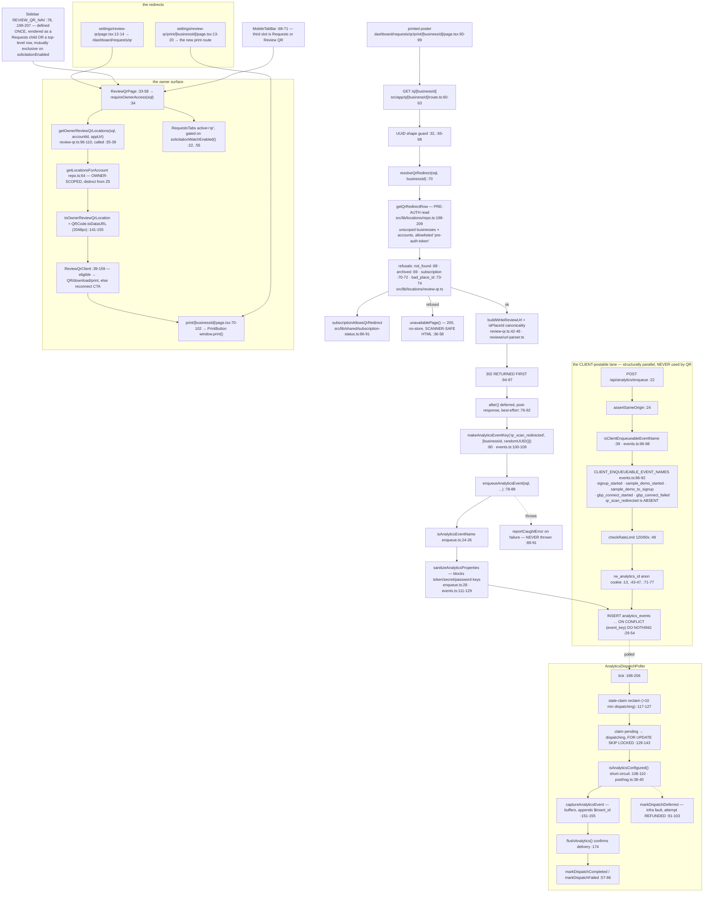

# F9 — Review QR and the analytics boundary

**Theme Z · `43afb2b71` #982 (Review QR — migration 115) · `4502ed1f8` #1110
(moved under `/dashboard/requests/qr`) · plus the owner-intake singletons
`862a039d1` #1109, `13540eed6` #1101, `9c40633f8` #1100, `dec98bab5` #1123.**

**54 nodes.** Charted because it is the window's only new *public, unauthenticated*
route, and because it tests invariant #13's sibling rule — *durable facts are
NOT client-postable*.

---

## Correction to the brief

**The event is `qr_scan_redirected`, not `qr_scan`.**
`supabase/migrations/115_qr_scan_analytics_event.sql:44` and
`src/lib/analytics/events.ts:31`.

## The scan lane

## The analytics boundary — the rule holds, and it is enforced in the right place

`qr_scan_redirected` is a **server-side durable fact and is correctly NOT
client-postable.** `CLIENT_ENQUEUEABLE_EVENT_NAMES` (`events.ts:86-92`) lists
exactly five: `signup_started`, `sample_demo_started`,
`sample_demo_to_signup`, `gbp_connect_started`, `gbp_connect_failed`.
`qr_scan_redirected` is absent. The QR route inserts directly via
`enqueueAnalyticsEvent` (`route.ts:78-88`), never through
`/api/analytics/enqueue`.

The allowlist's own comment (`events.ts:81-85`) states the rule better than
CLAUDE.md does: *"Durable state-change facts … are owned by workers/route
handlers after a DB commit and must NOT be client-postable, or anyone could
forge the activation funnel."* **This is the correct side of the line, and the
reasoning is recorded at the allowlist rather than in a doc.**

## Three design properties worth copying

1. **The 302 is returned before the analytics write.** `route.ts:94-97`
   returns; `after()` at `:76-92` runs the insert post-response. A scanner
   never waits on an analytics row, and `reportCaughtError` at `:89-91`
   guarantees an insert failure never reaches the visitor.
2. **The refusal page is scanner-safe.** `unavailablePage()` (`:36-58`)
   returns **200** with no-store HTML rather than a 404 — because a phone
   camera's in-app browser renders a 404 as a dead end. The status code is a
   product decision made against the actual client, and it is commented as
   one.
3. **Two reads, two scopes, deliberately not shared.** `getQrRedirectRow`
   (`repo.ts:198-209`) is an unscoped pre-auth join, explicitly allowlisted as
   `pre-auth-token` in `tenant-scope-allowlist.ts`; `getLocationsForAccount`
   (`repo.ts:64`) is the owner-scoped read. Two functions in one file for two
   trust models. **Legitimate specialization — DO NOT unify.** New register
   entry.

## The owner-intake singletons

| Merge | What it added | Note |
|---|---|---|
| `9c40633f8` #1100 | `src/lib/shared/password-rules.ts` — one owner for `passwordSchema`, both submit guards, and the displayed requirements list | **Replaced three hand-written copies, one of which was wrong.** The model for every other "N spellings of one rule" finding in this pass |
| `862a039d1` #1109 | `src/lib/shared/business-categories.ts` — 15 groups / 92 subcategories `as const`; `resolveVertical` gains a **total** `SUBCATEGORY_VERTICALS` table consulted before the keyword matcher | Measured before the change: keyword matching dropped **48 of 92** to `other` and resolved **two wrongly** — and a vertical picks a freshness window, so those were wrong send/withhold decisions, not mislabels |
| `13540eed6` #1101 | `src/lib/solicitation/contacts-csv-template.ts` (pure, `todayUtc` injected) + `TemplateCard.tsx` | Built in code rather than shipped as a static asset **so one eval suite feeds the template back through `parseContactsCsv`** — a template that drifts from the header contract would earn `missing_required_header` and discard the whole upload |
| `dec98bab5` #1123 | Import-offer actions take a slot instead of an inline flex | |

#1109's before-measurement is the single best piece of engineering evidence in
the window: it quantified the defect (48/92 wrong bucket, 2 actively wrong)
*before* choosing the fix, and the fix was a total table rather than a better
heuristic.

## Defects

None found. The QR lane's three reads are each correctly scoped, the analytics
event is on the correct side of the client boundary, the `ON CONFLICT
(event_key)` dedup is present (`enqueue.ts:29-54`), and the poller refunds the
attempt on an infra fault (`markDispatchDeferred`, `:91-103`) rather than
burning it — the same fail-open-but-safe posture CLAUDE.md's cost-guard gotcha
describes.
