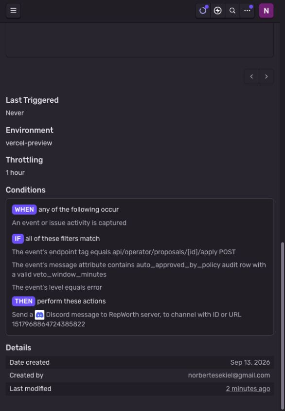
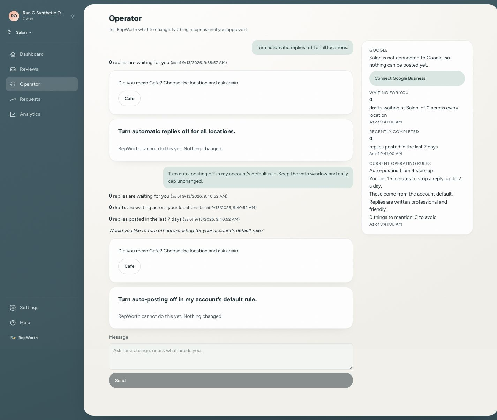
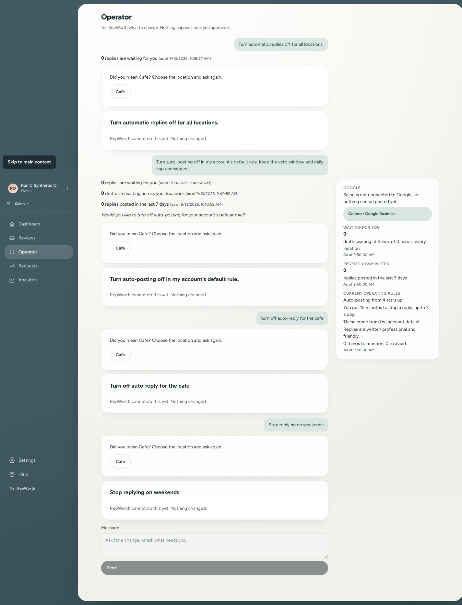
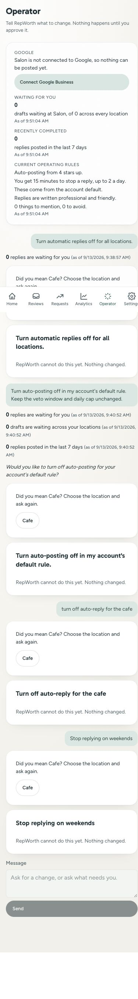

# Evidence — Owner Operator Run C deployed acceptance

Runbooks: [deployment](../deployment-guide.md), [alerting](../beta-launch-alerting.md), and Owner Operator spec §12.2.

## Environment

- Staging only: Supabase `kubdiqdhqbhwmqfditeg`; production `udeyaqnvpojbwgoaxwdg` NEVER used for fixtures.
- UI: https://staging.repworth.net; worker: https://repworth-worker-staging.up.railway.app.
- Candidate: `fb536c09711ec331262f5efc64ff42f066bec3ba`, branch `codex/owner-operator-run-c` in the sibling worktree.
- UTC start: 2026-09-13T16:23Z. No remote fixture created at start.
- Stripe: no billing operation planned. Synthetic owners and locations only; no live Google profile connection or posting.
- Keep global auto-approval off. Production Owner Operator remains off. This campaign does not choose the human pilot owner/window.

## Preflight

| Check | Result | UTC |
|---|---|---|
| Final local gate | PASS at candidate; fingerprint `004dbf390c202dbcd53ac9696710df205158a989cffb12277712affaf9e1120f`; full gate, build, E2E, DB suites, audits and coverage | 16:21Z |
| Red-team status | CLEAR, 785 inventory rows, 389 killed, 396 excluded, seven fixed findings; third round 22/30 local launches | 16:21Z |
| Feature state | `reviewed`, all findings triaged; no temporary mutation or dotenv swap remains | 16:22Z |
| Remote baseline | main `6b2eb580940480c6a9b304f3e69c0d7a3bb04f29`; staging `f32dd15c7060e134dd926fb0e64df988c5456d0f` | 16:20Z |
| Current staging UI | READY `dpl_Br8qB2iLy7im3vZj4Z6aYZq7UX95`, staging branch at baseline SHA | 16:21Z |
| Claude code review | Automatic review workflow disabled manually; separate active mention-triggered workflow requires an explicit Claude tag, which this campaign does not send | 16:20Z |
| Sentry alert | PASS: saved enabled rule `3985600`, staging project only, `vercel-preview`, every event, all endpoint/message/error filters, Discord RepWorth channel `1517968864724385822`, 60-minute throttle | 16:26Z |
| Sentry deployment environment | Draft corrected to `vercel-preview`: installed SDK uses `VERCEL_ENV`, not `VERCEL_TARGET_ENV`; project and shared searches show neither SENTRY_ENVIRONMENT nor VERCEL_ENV overrides; system variables enabled | 16:25Z |
| Worker deployment and flag baseline | SUCCESS `468df3cd-71a2-45a0-8cea-f0643eac2172` at staging baseline SHA; OWNER_OPERATOR=true, AUTO_APPROVAL=false, JUDGE=true, MOCK_EXTERNAL_APIS=false, environment=staging | 16:24Z |
| Candidate UI and worker deployment SHA | PASS: UI `dpl_6JjLZCju9QQLAsvY3iYfSuQTcSM8` READY; worker `453a82f8-62c6-4988-83e8-a6526fbab8ee` SUCCESS; both `fb536c09711ec331262f5efc64ff42f066bec3ba`; worker /ready reports PostgreSQL, queue Redis and cache Redis all OK | 16:32Z |
| Draft PR | https://github.com/RepWorth/ai-review-responder/pull/1278 ; staging fast-forwarded to candidate | 16:30Z |

## Deviations log

- D-1 (16:23Z): This evidence file is held in the main checkout for the separately authorized post-merge closeout docs PR. The reviewed feature worktree stays frozen so runtime evidence does not invalidate its committed adversarial baseline. User changes in the main checkout are preserved. No runtime PASS is inferred from this preparation.
- D-2 (16:23Z): The Vercel CLI token is invalid. Authenticated Vercel connector metadata and the signed-in in-app Vercel UI provide readback; no credential store is inspected.
- D-3 (16:25Z): Corrected the UNSAVED alert draft from `vercel-staging` to `vercel-preview`. Vercel documents VERCEL_ENV as production/preview/development, with custom staging in VERCEL_TARGET_ENV instead. The installed Sentry Next.js server SDK derives `vercel-${VERCEL_ENV}` and this app supplies no explicit environment. Project/shared configuration searches found no overriding variables. This is configuration-derived evidence, not a live error-delivery drill. Source: https://vercel.com/docs/environment-variables/system-environment-variables#vercel_env.
- D-4 (16:29Z): Initial pre-push typecheck found malformed ignored `.next/dev/types/validator.ts` after the full gate. No Next server or Playwright process remained. Preserved the generated directory in `/private/tmp/run-c-malformed-dev-types-0927`, regenerated with `next typegen`, and reran typecheck successfully. The subsequent safe-environment pre-push passed all checks, including 81 affected suites / 1170 tests with the local DB. No tracked source changed and the final gate fingerprint remains current. The first attempt had DB suites skipped because it lacked the local wrapper; it is not cited as DB verification.
- D-5 (16:37Z): Synthetic account seed omitted `onboarding_wizard_completed_at`, so successful login correctly routed to onboarding. Set the completion stamp only on this fixture through staging MCP after checking `resolveFunnelEntry`; no Google connection or place data was needed. Operator then loaded and Salon was selected.
- D-6 (16:38Z): Account/location/policy writes use staging MCP. Historical review INSERTs and their origin markers run together through a root-reviewed scratch helper using the existing run-spine writer and an explicitly validated staging connection; this preserves the same-transaction marker invariant that raw MCP SQL could not exercise through the TypeScript writer. The helper calls no provider or enqueue operation. These are labelled synthetic history fixtures, not evidence of ingestion delivery.

## Saved alert configuration

Rule: https://repworth-nv.sentry.io/monitors/alerts/3985600/ . Readback confirms enabled, staging project, web environment, all three filters, every-event trigger, existing Discord integration and 60-minute throttle. No test notification was sent; Last Triggered remains Never.

## Teardown ledger

| Item | Identifier | Removal or disposition | Status |
|---|---|---|---|
| Persistent staging retained-veto alert | https://repworth-nv.sentry.io/monitors/alerts/3985600/ | Intended release configuration; retain. UI readback confirms enabled, required filters/destination and one-hour throttle; zero triggers, no delivery drill claimed | RETAINED / VERIFIED 16:26Z |
| Synthetic owner/Auth sessions | `run-c-fb536c09@e2e.repworth.net`; Auth ID `e6259d41-fc9f-4193-be3c-9ca0a522a651` created 16:32Z | Revoke sessions, delete exact Auth ID after email identity check using admin API, verify getUserById absent and zero sessions; password stays only in task memory | OPEN |
| Synthetic account and two locations | Account `019f43c0-0000-7000-8000-000000000001`, user `019f43c0-0000-7000-8000-000000000002`, Salon `019f43c0-0000-7000-8000-000000000011`, Cafe `019f43c0-0000-7000-8000-000000000012`; created transactionally via staging MCP at 16:37Z; readback active Autopilot account and two named locations | Delete account-scoped dependent rows then locations/account/user; query zero residue | OPEN |
| Review cohort, policies, turns, proposals, audits, run spine, usage | Policy `019f43c0-0000-7000-8000-000000000021`; reviews `019f43c0-0000-7000-8000-000000000101` through `...000110`; committed history result `/private/tmp/run-c-staging-history-result.json` captures nine exact run/step IDs | Complete ordered SQL ledger prepared and root-reviewed in `/private/tmp/run-c-staging-fixtures.md`; terminal turns/outbox first, then exact account-scoped deletion and ID-based zero readback | OPEN; seed counts verified 10 reviews, 9 runs/steps, 8 live / 1 imported / 1 unknown |
| Feature flags | No changes planned | Verify baseline at preflight and teardown | PENDING |

## Unproven paths

- CLOSED: Sentry rule configured and read back at 16:26Z (delivery is a separate check).
- CLOSED: Candidate UI and worker serve reviewed SHA; healthy dependency readback.
- Real worker/provider turn produces ten-review consequences and an accurate applied receipt: eight included, two excluded; eligible 5 to 0; held 3 to 8; two inheriting locations; zero retained veto grants.
- Exact Cafe scope conflict shows chooser and stores zero proposals.
- Exact weekend request stores unsupported capability and renders no Apply.
- Actual 390px/1440px rendered states, plus failed-turn state with accurate fixture labeling.
- Verified complete cleanup and unchanged flags.
- After merge, deployed squash SHA and repeated real scope-card journey.

## Real turn observations — open behavior defect

- First turn `01a09ba2-ccc4-7228-ba3a-3c8736e2ceaf`, conversation `b03d88c5-7eb5-4220-8957-b914f85c5cd6`, outbox `01a09ba2-cdcd-7149-87f6-755b8c0187dd`: exact instruction `Turn automatic replies off for all locations.` Completed 16:38:59Z on attempt1; outbox completed. Returned a pending-count segment, Cafe scope chooser and stored unsupported request `01a09ba2-e60a-74f1-a73b-38ca89e981e1`; zero proposals. Expected account-default contraction was NOT produced.
- Clarification turn `01a09ba4-8f2c-73be-b918-f156793332b4`: `Turn auto-posting off in my account's default rule. Keep the veto window and daily cap unchanged.` Completed 16:40:54Z. Returned counts, a confirmation question, Cafe chooser and unsupported card; zero proposals again. This was a normal clarification, not a changed policy fixture.
- Actual OpenAI cost rows `01a09ba2-e59b-7753-a87e-d5472941f33f` and `01a09ba4-a58d-714b-b1c1-a5dd8b644cc1` show prompt version `2026-09-13.3`, hash `3f280d00e307c2148b9138dbf8c51ed5f4d70ca84dd63c1057535c4ba32da81a`, latencies2080/1637ms and costs USD0.000415/0.000451. These were real worker/provider attempts, not seeded terminal replies.
- Candidate scope-card acceptance remains FAIL/pending diagnosis. No policy Apply, response creation or posting occurred. Preserve these failures; do not replace them with a later successful wording.

## Campaign closure and diagnosis

- Exact Cafe turn `01a09ba7-b364-77e2-9fa6-4fdd4d427ad2` stored Salon as its accepted location and produced a Cafe chooser with zero proposals. It also incorrectly recorded the supported change as unsupported.
- Exact weekend turn `01a09bac-d106-72c9-92d6-eb2f4ba24b31` stored an unsupported request and no proposal, but included an unrelated Cafe chooser. Reload preserved both outcomes. All four turns used the same conversation because navigating to the base Operator URL automatically resumed it; fresh-conversation coverage is still required for the correction.
- [Sanitized backend readback](owner-operator-run-c-2026-09-13/failed-campaign-readback.json) records all four terminal turns/outbox rows, unsupported IDs and OpenAI cost rows: USD0.001707 total, no retries, unchanged account policy threshold4/veto15/cap2, zero proposals/responses. Provider/schema completion is not semantic success.
- Native Codex diagnosis established that the actual OpenAI schema supports null account scope and null threshold. The likely defect is prompt interpretation of scope/readiness, potentially reinforced by prior conversation history. No schema, writer or Apply-gate change is indicated by this evidence.
- Teardown CLOSED at16:54Z: UI signout returned to login, Auth sessions were zero before deletion; the exact Auth identity was deleted through the supported admin API. Four exact terminal BullMQ jobs were identity-checked and removed over Railway SSH inside the staging worker. The ordered account-scoped SQL transaction removed fixture data. [Zero-residue readback](owner-operator-run-c-2026-09-13/failed-campaign-cleanup.json) reports zero across all25 SQL/Auth/ID checks. [Historical marker IDs](owner-operator-run-c-2026-09-13/history-fixture-ids.json) are retained as evidence. This closes every OPEN fixture row in the earlier teardown ledger.
- Worker flags remain OWNER_OPERATOR=true, AUTO_APPROVAL=false, JUDGE=true, MOCK_EXTERNAL_APIS=false in staging. No production flag changed. Browser viewport override reset and synthetic session ended. Sentry rule3985600 remains intentionally enabled.

## Verdict

FAIL for candidate fb536c09 deployed acceptance. Fixtures are fully cleaned up. PR1278 remains draft; prompt correction and repeated deployed acceptance are required before C can merge.

## Local correction verification (not yet deployed)

At17:03Z, the owner explicitly authorized five synthetic OpenAI API checks after automatic approval review had rejected the initial proposed call. No call ran before that authorization. [Sanitized results](owner-operator-run-c-2026-09-13/openai-prompt-correction.json) show5/5 PASS through the actual OpenAI adapter with registered `gpt-4o-mini-2024-07-18` and the unchanged task schema: existing location widening, both exact account-off phrasings, exact Cafe chooser and exact weekend unsupported request. Prompt version `2026-09-13.4`, hash `9a34adb4e8ac78d2970451e04002d29e37edb054cb7026b8a205bb0081c4a032`;14,083 input tokens and355 output tokens. No Anthropic calls, external delegates, customer data, database writes or model output text appear in this probe. This is one fresh synthetic attempt per case through the direct registered adapter, not deployed worker, repeated-sampling, fallback-provider or Apply/receipt proof.

The expanded evaluator first failed four focused tests because its regression cases were absent; after adding them, all17 evaluator tests passed. The prompt example and evaluator suites together pass21 tests. Full gate and fresh independent review are pending. The production diff is a targeted prompt clarification; most added lines are the four semantic fixtures and tests rejecting the exact observed wrong outputs. No schema/provider/writer/Apply contract changed.

At17:06Z the full review gate passed on the prompt correction, fingerprint `d20f81ecbb86113488cfe2981ccf88c51a21e7b68bf33ef5043b60f422f8d361`: lint, typecheck, build, E2E, tenant/RLS/CI audits, live integration checks and full test run15869pass/11skip. The separate coverage run intentionally skipped the live-DB lane; the full extra `pnpm test` run and named integrations provide database proof. Sandboxed process inspection initially misreported the active verifier as dead; authorized inspection confirmed it was running, and no duplicate gate was started.

Independent Codex reviews approved maintainability and safety. Correctness found one evaluator P2: a weekend case counted unsupported rows without binding the stored request to scheduling. Root reproduced the exact wrong-policy-off counterexample, added scheduling relevance and two accepted paraphrases, and reran21focused tests successfully. The same reviewer verified the correction and approved it. These later test edits invalidate the17:06fingerprint until the final gate is rerun; the5/5live report is not retroactively evidence for the strengthened assertion, and the production prompt itself remains unchanged.

At that preparation checkpoint, the owner explicitly approved a Run C-only fourth adversarial round with at most150local launches after reviewing `/private/tmp/run-c-fourth-round-proposal.md`. The exact grant was appended to the historical sidecar; all785prior inventory rows/findings/counts remained unchanged pending new measurement. The runner/checker extension still required independent verification before use. No fourth round had opened at that checkpoint; no further provider calls were granted by this approval.

## Fourth-round verification in progress

The corrected candidate is now committed at `f207fe8fd03df2a1b9f896f401e9a5d4eac1fe39`. Independent Codex reviews approved the prompt correction and the scoped verifier extension after the accepted historical-Markdown preservation finding was corrected. The extension's two guard suites pass168tests. The exact-commit full local gate passes15,911tests with11skipped, plus build, E2E and the required audits; fingerprint `cc6dfc2a8c16324bc373ee145fa97aa17df2ffe8d26e3a9fad4c6737db25791e`. This gate used the documented lower concurrency of two gate rows and two Vitest workers after an earlier default-concurrency run timed out in two unchanged admin CLI tests. Both the failed run and the successful isolated/admin and full runs remain recorded; no test timeout or assertion was weakened.

The guarded fourth round is open under the exact owner grant. Its complete delta inventory has216candidates:63individual cases selected for baseline/mutant measurement and153explicit unchanged-dataflow exclusions. The planned126launches fit the150launch ceiling. An immutable controller and root-owned finalizer restore source and dotenv files after each case; any surviving mutation requires a source-backed outcome decision. Historical JSON rows and raw Markdown bytes remain preserved. Final fourth-round verdict and the report-commit gate are pending; these preparations do not certify deployed acceptance.

Read-only staging preflight still shows the old `fb536c09711ec331262f5efc64ff42f066bec3ba` on both UI and worker. Count queries return zero for the fixed synthetic account, user and locations, the old Auth email, and the proposed corrected-campaign email `run-c-f207fe8f@e2e.repworth.net`. No corrected-campaign fixture has been created. The next campaign will use three separately seeded empty conversations; all model outputs and policy changes must still come from actual browser turns, the deployed worker, and Apply.

Fourth-round measurements are now complete:63individual baseline/mutant pairs,126of150authorized launches,56assertion kills and7root-accepted equivalent survivors,153explicit exclusions, zero new actionable findings and zero incomplete scoped rows. Every baseline passed and each run selected exactly one test. The root finalizer's `R4-FINAL` acknowledgment confirmed all126process groups empty and no source or dotenv restoration outstanding. The diagnostic-only kill R4-0161 concerns the specific schema error message; an independent check still rejects the unauthorized report.

Report-only commit `a8b934a69434476ce41d056c0d846b03129fe994` preserves all785complete historical rows, all prior findings and authorizations, and the exact557,236-byte Markdown prefix. Root compared every one of the63durable measurement blocks to the actual recorded attempts. The canonical checker passes round4/CLEAR with1001combined rows:445killed,7equivalent,549excluded; all7historical findings remain fixed. The final full gate is running on this report commit. This closes local adversarial measurement, not corrected deployed acceptance.

Read-only shipping preflight confirms PR1278 remains draft; remote main is `6b2eb580940480c6a9b304f3e69c0d7a3bb04f29` and staging is still `fb536c09711ec331262f5efc64ff42f066bec3ba`. Automatic Claude Code Review remains `disabled_manually`; the separate mention-triggered workflow receives no mention. CI's LLM eval is offline and keyless. The staging Railway connector returned variable names without values, so a bounded CLI read privately selected only four nonsecret flags: OWNER_OPERATOR=true, AUTO_APPROVAL=false, JUDGE=true, MOCK_EXTERNAL_APIS=false.

## Corrected staging campaign — a8b934a6

The final full gate is GREEN at `a8b934a69434476ce41d056c0d846b03129fe994`, fingerprint `acdbdcdb03b7958d3a5e60e29464c30f3feeaa2795f307726d8bfe02c51e6432`. The full DB-enabled suite reports15,911passed/11skipped; the separate coverage run reports14,657passed/1,255skipped, with the live-DB lane intentionally excluded there. Build, E2E, required integrations, audits and coverage checks pass. The reclassification warning remains explicitly adjudicated in the committed deviation. The canonical checker passes and feature state is `reviewed`.

At18:49Z, the reviewed commit was pushed atomically to the feature branch and staging. Pre-push lint, typecheck, audits and82affected suites/1,268tests passed with the disposable local database. PR1278 remains draft with the corrected verification record. Vercel staging deployment `dpl_HYuAotXunk5SXdQ7itAWbqhWispn` and Railway staging deployment `4a255a75-2391-4e76-a43c-bd0cbb1238fc` were queued for the exact commit; neither is claimed ready by this entry.

Environment and posting posture remain the staging-only constraints above. The corrected campaign uses `run-c-f207fe8f@e2e.repworth.net`, fixed application IDs only after fresh absence checks, and three empty conversations31/32/33. Source correction is `f207fe8f`; deployed/report candidate is `a8b934a6`. The prior failed campaign and its cleanup remain unchanged.

### Corrected campaign teardown ledger

| Item | Identifier | Removal / verification | Status |
|---|---|---|---|
| Synthetic Auth identity and sessions | Email `run-c-f207fe8f@e2e.repworth.net`; actual Auth UUID `0897c3a7-ab01-4804-9916-20d65dda9f18`, created through admin API at18:52Z | UI signout, verify sessions zero, exact email-checked admin deletion, identity/session count readback | OPEN; credential retained only in private task memory |
| Synthetic account, application user and locations | Account `019f43c0-0000-7000-8000-000000000001`; user `...000002`; Salon `...000011`; Cafe `...000012`, seeded transactionally via staging MCP | Ordered exact-account teardown guarded by actual Auth UUID `0897c3a7-ab01-4804-9916-20d65dda9f18`, then zero-count readback | OPEN |
| History, policy, conversations and generated runtime rows | Policy `...000021`; reviews `...000101`–`...000110`; conversations `...000031`–`...000033`; actual nine run/step IDs in [corrected history manifest](owner-operator-run-c-2026-09-13/corrected-history-fixture-ids.json) | Wait for terminal turns/outbox, remove only captured terminal BullMQ jobs, exact-account SQL cleanup and captured-ID zero checks | OPEN; three conversations initially empty; history committed with10reviews/9runs/9steps,8live/1imported/1unknown |
| Flags and browser viewport | OWNER_OPERATOR=true; AUTO_APPROVAL=false; JUDGE=true; MOCK_EXTERNAL_APIS=false; baseline viewport reset | Preserve flags, read back at teardown, sign out synthetic session and reset viewport | BASELINE RECORDED |

Corrected acceptance remains unproven: exact account-default contraction and ten-review card/receipt hand count; selector movement and repeated Apply; exact Cafe-only chooser; exact weekend scheduling capture;390px/1440px evidence; complete cleanup. Post-merge scope-card repetition remains a separate final Run C obligation.

At18:52Z, both candidate deployments are ready: Vercel confirms `staging.repworth.net` aliases `dpl_HYuAotXunk5SXdQ7itAWbqhWispn`, Railway reports `4a255a75-2391-4e76-a43c-bd0cbb1238fc` SUCCESS, and both pin `a8b934a69434476ce41d056c0d846b03129fe994`. Worker `/ready` returns ready with PostgreSQL, queue Redis and cache Redis all `ok` (18:52:24Z). The seven fresh fixture absence checks all return zero. Synthetic Auth creation has begun the campaign; no turn or policy write has occurred yet.

### Corrected account-default turn before Apply

The independent hand count below records the **executed synthetic seed inputs** from the reviewed fixture helper, used by both corrected and post-merge campaigns. It is not a retained per-review database readback. The runtime manifests retain actual review/run/step IDs and origins; the proposal/receipt JSONs retain the server-computed results. Review IDs share prefix `019f43c0-0000-7000-8000-` and the twelve-digit suffix shown below. The old rule is threshold4/cap2 per location per UTC day; off holds every included review for manual approval.

| Review suffix | Location | Stars | Detected at (UTC) | Origin marker | Expected old rule | Expected off rule |
|---|---|---|---|---|---|---|
| 000000000101 | Salon | 5 | 2026-09-11 09:00 | live | eligible | manual hold |
| 000000000102 | Salon | 4 | 2026-09-11 10:00 | live | eligible | manual hold |
| 000000000103 | Salon | 5 | 2026-09-11 11:00 | live | cap hold | manual hold |
| 000000000104 | Salon | 3 | 2026-09-11 12:00 | live | below-threshold hold | manual hold |
| 000000000105 | Cafe | 5 | 2026-09-11 09:00 | live | eligible | manual hold |
| 000000000106 | Cafe | 2 | 2026-09-11 10:00 | live | below-threshold hold | manual hold |
| 000000000107 | Cafe | 4 | 2026-09-11 11:00 | live | eligible | manual hold |
| 000000000108 | Salon | 5 | 2026-09-10 09:00 | live | eligible | manual hold |
| 000000000109 | Salon | 5 | 2026-09-11 13:00 | imported | excluded | excluded |
| 000000000110 | Cafe | 5 | 2026-09-11 13:00 | absent (unknown) | excluded | excluded |

Thus the old rule has5eligible and3held (2below threshold,1cap); off has0eligible and8manual holds. Both exclude1imported/1unknown; the busiest included UTC day contains7reviews. The seed transaction inserted no response, approval grant, connection or outbox work. Actual Operator turn and Apply outcomes are recorded separately below.

The exact request `Turn automatic replies off for all locations.` was sent through the in-app browser with Salon selected and conversation31 empty. Turn `01a09c1f-f5aa-768d-8600-0baccf86d849` completed on attempt1 at18:55:39Z, with only proposal `01a09c20-069f-700d-989a-0d03986d6637`. Outbox `01a09c1f-f6af-76b1-92fe-29fff57a5bf8` completed once. OpenAI cost row `01a09c20-04d9-71fa-836f-8cfaa9c07a3c` records prompt2026-09-13.4/hash9a34adb4e8ac78d2970451e04002d29e37edb054cb7026b8a205bb0081c4a032,2,865input/81output tokens,2,073ms,USD0.000478. No fallback or retry occurred.

[Stored pre-Apply evidence](owner-operator-run-c-2026-09-13/corrected-before-apply.json) confirms account-default scope, existing row, two inheriting locations, threshold4→null, veto15/cap2 unchanged. Both consequence cohorts include8reviews and exclude1imported/1unknown; the old rule has5eligible/3held (2rating,1cap), the new rule0eligible/8manual; busiest included day7. The actual card renders the new-rule hand count and one-click Apply at [1440px](owner-operator-run-c-2026-09-13/corrected-scope-1440.jpg) and [390px](owner-operator-run-c-2026-09-13/corrected-scope-390.jpg). DOM geometry reports widths1440/390 and no horizontal overflow. Changing the global selector to Cafe leaves the card labelled Account default and affecting2inheriting locations.

D-7: A read-only evidence query initially requested nonexistent `api_costs.metadata` and failed before returning data. Schema introspection resolved the actual `prompt_version`/`system_prompt_hash` columns; the corrected query above uses them. No fixture or product state was changed by that failed read.

### Applied receipt and real-UI replay

First Apply at actual1440px succeeded at19:00:28.496Z. [Stored receipt and audit](owner-operator-run-c-2026-09-13/corrected-after-apply.json) show the existing account policy thresholdnull/veto15/cap2, actor `...000002`, exactly one audit `01a09c24-6ad4-729b-a740-852374079798`, old eligible5/held3 and new eligible0/held8, imported1/unknown1 excluded, two inheriting locations and retained-veto count0. The recomputed consequence timestamp is19:00:26Z, distinct from the18:55preview. Zero responses and zero connections exist. Expansion readiness remains blocked, while the contraction succeeds as required.

The second tab loaded the pending proposal before first Apply. Its actual viewport was390px; its still-visible Apply was clicked after the first transaction. It returned the original receipt and applied timestamp. Root compared the complete [post-replay database evidence](owner-operator-run-c-2026-09-13/corrected-after-replay.json) to the first-Apply readback: exact equality, same audit ID/count1, same policy and unchanged zero responses/connections. No API replay was fabricated or issued through browser evaluation. Saved receipts: [1440px](owner-operator-run-c-2026-09-13/corrected-receipt-1440.jpg), [390px](owner-operator-run-c-2026-09-13/corrected-receipt-390.jpg). Both layouts have no horizontal overflow.

D-8: The viewport capability affected the active second tab, so the intended first mobile Apply actually occurred at1440px. DOM measurements established first1440×900 and replay390×844 before the second click. Evidence therefore records first Apply on desktop and the actual replay on mobile; it does not relabel the first action. The second tab was closed after receipt capture.

### Corrected Cafe and weekend acceptance

At19:07Z, exact `turn off auto-reply for the cafe` in empty conversation32 with Salon selected completed as turn `01a09c2a-b077-778a-b498-c82c284a6dae`. Its sole stored segment is `scope_check` for Cafe `...000012`; the accepted location remains Salon `...000011`. No proposal or unsupported row was created for this turn. The Cafe-only chooser persists on a fresh page load, captured at [1440px](owner-operator-run-c-2026-09-13/corrected-cafe-1440.jpg) and [390px](owner-operator-run-c-2026-09-13/corrected-cafe-390.jpg).

At19:09Z, exact `Stop replying on weekends` in empty conversation33 with Salon selected completed as turn `01a09c2c-469a-7114-9d39-802b5ae6ada5`. Unsupported row `01a09c2c-5e05-7148-83d9-80bef2e67789` stores that exact scheduling request and links to this turn. No proposal or scope chooser was created. The card has no Apply and persists after reload, captured at [1440px](owner-operator-run-c-2026-09-13/corrected-weekend-1440.jpg) and [390px](owner-operator-run-c-2026-09-13/corrected-weekend-390.jpg). This fresh deployed result provides the scheduling-binding proof that the earlier direct probe did not establish under the later strengthened assertion.

[Final runtime readback](owner-operator-run-c-2026-09-13/corrected-final-readback.json) captures all3completed first-attempt turns,3completed outbox rows,1applied proposal and1unsupported request. Three OpenAI cost rows total USD0.001389,8,593input/167output tokens; each uses prompt2026-09-13.4/hash9a34adb4e8ac78d2970451e04002d29e37edb054cb7026b8a205bb0081c4a032. No Anthropic calls, fallback or retry occurred. Final count-only readback confirms responses0, connections0, approval audits0 and account audit1.

D-9: After closing the replay tab, viewport changes did not affect the old primary tab. A fresh tab from the same in-app browser restored390px sizing. Full-page1440px captures returned blank images despite a populated DOM; ordinary viewport captures correctly show both cards and replace the blank capture files. Mobile full-page images retain the fixed navigation at its viewport position. DOM measurements establish1440×900 and390×844, with no horizontal overflow. These are browser capture limitations; no application code changed.

Teardown started at19:10Z: real UI signout reached the login screen, and the exact synthetic Auth identity has0sessions. Queue/SQL/Auth deletion and final residue checks remain OPEN.

### Corrected campaign final verdict

PASS for corrected pre-merge staging acceptance at `a8b934a69434476ce41d056c0d846b03129fe994`. All three exact requests, account-default consequence hand count, actual Apply receipt, selector pinning and real mobile replay are proven. Desktop/mobile layouts and persisted unsupported scheduling are captured. The earlier failed candidate remains a separate FAIL above.

Teardown CLOSED at19:14Z. The three captured completed BullMQ jobs were individually account-checked, removed and read back absent. The exact-account SQL transaction completed and the email-checked Auth admin API removed identity `0897c3a7-ab01-4804-9916-20d65dda9f18`. [Cleanup readback](owner-operator-run-c-2026-09-13/corrected-cleanup.json) returns0for all25SQL/Auth/captured-ID checks. This closes all OPEN rows in the corrected teardown ledger. Synthetic tabs are closed, private credential memory cleared and viewport override reset. Worker flag readback remains OWNER_OPERATOR=true, AUTO_APPROVAL=false, JUDGE=true, MOCK_EXTERNAL_APIS=false.

Vercel's staging AUTO_APPROVAL variable is a write-only Secret, last updatedJul22; its editor exposes no stored value. It was cancelled without saving. The deployed Apply receipt's server-generated `auto_approval_disabled` blocker independently establishes the effective false value during the campaign. No Vercel variable or production flag changed. The retained-veto Sentry rule remains intentionally enabled. Post-merge scope-card repetition is still required before closing Run C.

## Run C merge and post-merge staging repeat

PR [1278](https://github.com/RepWorth/ai-review-responder/pull/1278) squash-merged at19:22:35Z as `280d1b0137f4f5a3e2cd613abe7464238d0f665e`. Required CI passed: lint, full tests with coverage, build, offline LLM eval, E2E and fallow; deploy-install was correctly path-skipped. React Doctor reports86/100,0errors/28warnings. The mention-triggered Claude job skipped; automatic Claude Code Review remains disabled. The squash tree is byte-identical to reviewed `a8b934a6` (`git diff --stat` empty).

Staging realignment to that exact squash is in progress using an explicit lease on previous `a8b934a6`, with the safe local-DB pre-push wrapper. No destructive local reset is used. Post-merge fixtures must wait for both deployment identities to match the squash and readiness to pass.

### Post-merge teardown ledger (before fixture creation)

| Item | Identifier | Removal / verification | Status |
|---|---|---|---|
| New synthetic Auth identity | Reuse now-absent `run-c-f207fe8f@e2e.repworth.net`; actual new UUID must be recorded from create response | UI signout, session-zero check, exact email/UUID admin deletion and Auth-zero readback | PLANNED; no identity yet |
| Synthetic account/user/locations/policy | Reuse fixed `019f43c0-...000001/2/11/12/21` only after new absence readback | Same reviewed actual-Auth-bound teardown transaction | PLANNED |
| Ten-review history and empty conversations | Reviews101–110; conversation31 for real scope-off turn,32/33 remain empty | Capture new marker and runtime IDs, remove exact terminal queue jobs,25zero-count checks | PLANNED |
| Flags and viewport | OWNER_OPERATOR=true,AUTO_APPROVAL=false,JUDGE=true,MOCK_EXTERNAL_APIS=false in staging; no Vercel changes | Read back flags, sign out, reset viewport, close synthetic tab | BASELINE UNCHANGED |

This is a fresh post-merge scope-card journey. Prior campaign IDs and evidence are retained; no prior result is presented as the post-merge result.

At19:25:46Z, Vercel `dpl_GJkm2X4Tj8ASUh1N5u1NGinsRCQT` is READY with alias `staging.repworth.net`, Railway `084a19ea-31a0-4a03-a441-15464affc914` is SUCCESS, both pin `280d1b0137f4f5a3e2cd613abe7464238d0f665e`, and `/ready` reports PostgreSQL/queue Redis/cache Redis allok. Seven fresh fixture absence checks return0. GitHub's completed coverage run records15,911passed/11skipped,1,177passed suites/1skipped.

Post-merge Auth ledger is now OPEN: new UUID `91763119-1eab-42d0-9d47-9038a5cef0ea`, email `run-c-f207fe8f@e2e.repworth.net`. Password remains only in private task memory. Account/history seeding follows; no turn has been sent yet. The prior Auth UUID is not reused.

Post-merge application/history ledger is OPEN: exact account/user/Salon/Cafe/policy IDs and empty conversations31–33 were created in the Auth-bound transaction. The approved helper then committed10reviews and9run-spine markers together. [New history IDs](owner-operator-run-c-2026-09-13/postmerge-history.json) read back8live/1imported/1unknown. This is prepared synthetic history, not a claimed live ingestion journey.

### Post-merge scope-card result

Exact `Turn automatic replies off for all locations.` with Salon selected completed once as turn `01a09c3e-9a02-770a-9ce5-08c27b1ca0fc`, proposal `01a09c3e-b591-72c0-ba5b-f6e1975e6531`, outbox `01a09c3e-9b14-7154-8d14-3da5fb931a2b`. [Pre-Apply readback](owner-operator-run-c-2026-09-13/postmerge-before-apply.json) confirms the existing account-default rule, two inheriting locations, old5eligible/3held and new0eligible/8manual out of8live;1imported/1unknown excluded, busiestday7, veto15/cap2 preserved. OpenAI cost row `01a09c3e-b3d2-761c-b73d-1a389dd1a332` records1,853ms,2,865input/81output tokens,USD0.000478 and the corrected prompt identity; no retry/fallback.

Actual390px mobile Apply succeeded at19:30:09.848Z. [Persisted receipt/backend evidence](owner-operator-run-c-2026-09-13/postmerge-after-apply.json) confirms recomputation at19:30:07Z, the same hand counts, retainedVeto0, one unchanged-identity policy nowthresholdnull/veto15/cap2, and one audit `01a09c3f-98f5-70a5-ae24-e8867a2a0755` attributed to the synthetic owner. Responses0,connections0,approval audits0. The receipt persists after1440px reload. Captures: [scope1440](owner-operator-run-c-2026-09-13/postmerge-scope-1440.jpg), [scope390](owner-operator-run-c-2026-09-13/postmerge-scope-390.jpg), [receipt1440](owner-operator-run-c-2026-09-13/postmerge-receipt-1440.jpg), [receipt390](owner-operator-run-c-2026-09-13/postmerge-receipt-390.jpg). Measured widths1440/390 have no horizontal overflow.

The required post-merge behavior is proven. Teardown remains in progress; do not close this campaign until its final residue readback.

### Post-merge final verdict

PASS, teardown CLOSED at19:33Z. UI signout reached login and Auth sessions were0before deletion. The one captured terminal queue job was individually verified and removed. The reviewed transaction removed the account fixtures, and the supported Auth admin API deleted new identity `91763119-1eab-42d0-9d47-9038a5cef0ea`. [Final25zero checks](owner-operator-run-c-2026-09-13/postmerge-cleanup.json) prove no SQL/Auth/captured-ID residue. Worker flags read back unchanged; Vercel variables were not changed, and the receipt proves auto-approval disabled during Apply. Viewport reset, synthetic tab closed, private credentials cleared. No post-merge fixture remains OPEN. Production Owner Operator was never enabled.

Run C implementation, independent review, fourth-round verification, required CI, feature merge, corrected pre-merge acceptance and fresh post-merge scope-card acceptance are complete. The separately required documentation closeout PR is next. Runs D and E have not started; COO pilot owner/window and production enablement remain human decisions.
